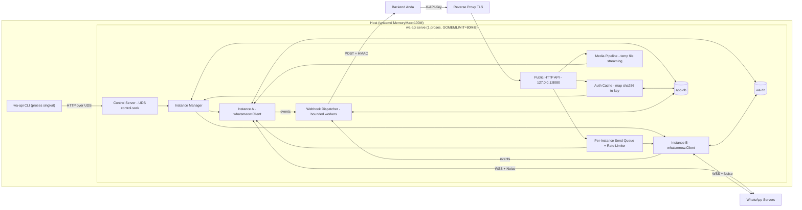
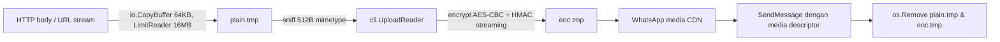
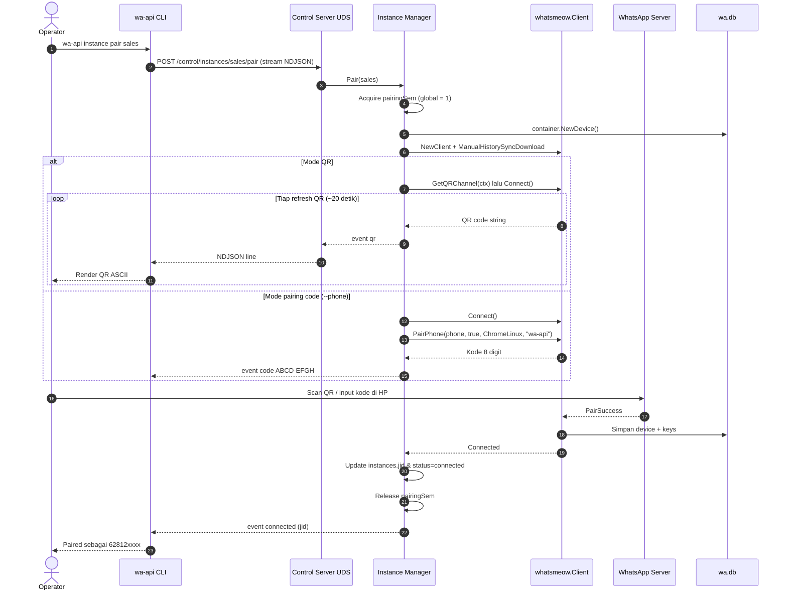
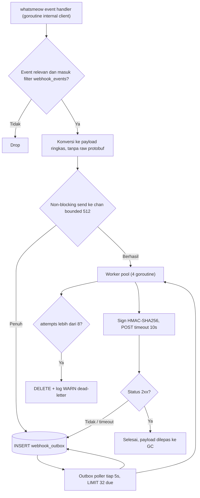
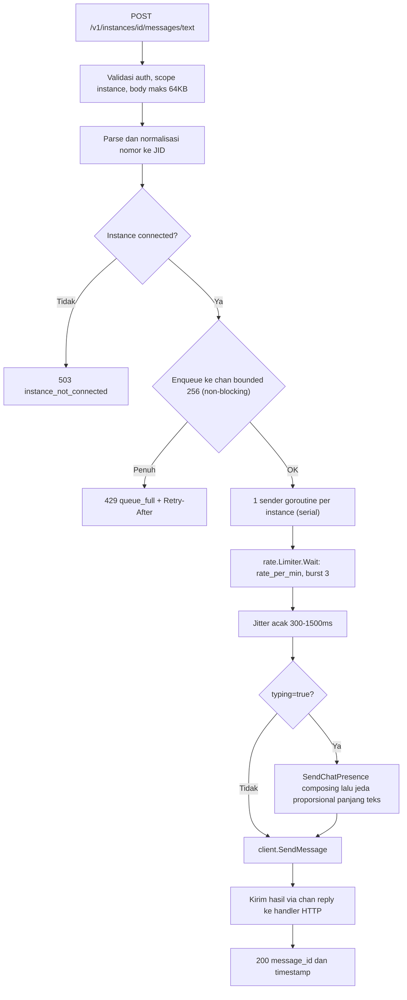

# ARCHITECTURE.md — `wa-api`: Private WhatsApp API Gateway (Headless, < 100 MB RAM)

> **Status:** Terimplementasi & teruji · **Target:** 1 binary statis (`waapi`), CLI-managed, multi-instance, private.
> **Hard constraint:** RSS total < 100 MB · idle < 40 MB · peak < 85 MB.

---

## 0. TL;DR Keputusan

| Aspek | Keputusan Final |
|---|---|
| Bahasa / Engine | **Go 1.25+ + `go.mau.fi/whatsmeow`** |
| Transport WA | WebSocket + Noise_XX_25519_AESGCM_SHA256 + Signal Protocol (native, tanpa browser) |
| Storage | **SQLite (pure Go `modernc.org/sqlite`)**, 2 file: `app.db` (metadata) + `wa.db` (crypto store) |
| HTTP | `net/http` stdlib (Go 1.22+ pattern routing), tanpa framework |
| CLI ↔ Daemon | **HTTP/1.1 over Unix Domain Socket** (`control.sock`, perm `0600`) |
| Auth API | `X-API-Key` → SHA-256 → lookup map in-memory (O(1)) |
| Webhook | Bounded channel + persistent outbox SQLite + exponential backoff + HMAC-SHA256 signature |
| Media | Streaming ke temp file → `UploadReader` → hapus. RAM konstan (~64–256 KB buffer) |
| History | **Dimatikan** (`RequireFullSync=false`, `ManualHistorySyncDownload=true`) |
| Kapasitas realistis | **3–6 instance aktif** per proses di bawah 100 MB |

---

## 1. Analisis First-Principles: Pemilihan Engine

### 1.1 Anatomi biaya memori sebuah session WhatsApp Multi-Device

Satu session MD (companion device) terdiri atas:

| Komponen state | Ukuran tipikal | Catatan |
|---|---|---|
| Noise handshake state + 2 cipher AES-GCM | < 2 KB | Hanya aktif per koneksi |
| Identity key pair, signed prekey, registration ID | < 1 KB | Persisten |
| PreKeys (one-time, ~ ratusan) | ~30–80 KB disk | Tidak perlu di RAM |
| Signal sessions (Double Ratchet per device kontak) | ~1–4 KB **per remote device** | Akun aktif: ribuan device → MB di disk, cukup di-load on-demand |
| Sender keys (grup) | ~1–2 KB per grup×sender | On-demand |
| App state (LTHash + mutation MAC) | ratusan KB – beberapa MB disk | Spike saat sinkron awal |
| WebSocket read/write buffer + frame decoder | ~64–256 KB | Per koneksi |
| Goroutine (read loop, keepalive, handler) | ~8 KB stack × ~10–20 | Kecil |

**Kesimpulan fisik:** state kriptografi inti *per session* di RAM hanya ~beberapa ratus KB **jika** store-nya di disk dan di-load on-demand. Yang memakan RAM sebenarnya adalah **runtime overhead**, **cache library**, **history sync blob**, dan **buffer media**. Maka pemilihan runtime + kebijakan history/media menentukan 80% hasil.

### 1.2 Perbandingan kandidat

| Kriteria | Node.js + Baileys | **Go + whatsmeow** | Rust (`whatsapp-rust` / custom) |
|---|---|---|---|
| Baseline runtime idle | V8 heap + isolate + libuv: **~45–70 MB** | Go runtime: **~5–8 MB** | **~2–4 MB** |
| Per session (aktif, tanpa history) | ~15–40 MB (objek JS, in-memory store, protobufjs) | **~3–8 MB** | ~2–5 MB |
| 5 session total | **~130–250 MB** ❌ | **~40–65 MB** ✅ | ~20–35 MB ✅ |
| GC behavior | Generational, heap cenderung tumbuh; `--max-old-space-size` memicu OOM crash, bukan throttling | Concurrent GC + **soft limit `GOMEMLIMIT`** (GC agresif mendekati limit) | Tanpa GC, deterministik |
| Kematangan protokol MD | Tinggi, komunitas besar | **Tinggi**, dipakai produksi oleh mautrix-whatsapp (bridge Matrix) → update protobuf cepat setelah WA berubah | Rendah/muda, port dari whatsmeow, risiko tertinggal update protokol |
| Stabilitas auto-reconnect | Perlu ditangani manual di userland | Built-in `EnableAutoReconnect`, backoff internal | Belum teruji luas |
| Store persisten | Harus bikin sendiri (default `useMultiFileAuthState` = ribuan file JSON, tidak untuk produksi) | **`sqlstore` resmi** (SQLite/Postgres), multi-device dalam 1 DB | Terbatas |
| Single static binary | ❌ (butuh Node runtime) | ✅ `CGO_ENABLED=0` | ✅ |
| Biaya pemeliharaan saat WA ubah protokol | Sedang | **Rendah** (upstream sangat aktif) | **Tinggi** (kemungkinan harus patch sendiri) |

### 1.3 Eliminasi

- **Node.js + Baileys — gugur.** Baseline V8 saja sudah memakan 45–70% budget. Dua session dengan event aktif sudah mendekati 100 MB. Batas `--max-old-space-size` bersifat *hard crash* (OOM), bukan *backpressure*, sehingga tidak bisa dijadikan pengaman budget.
- **Rust — gugur untuk produksi.** Secara memori pemenang, tetapi keunggulan ~20–30 MB tidak sebanding dengan **risiko protokol**: WhatsApp rutin mengubah skema protobuf, alur prekey, dan app-state. Library Rust yang ada adalah port muda; saat WA berubah, Anda yang harus reverse-engineer. Budget < 100 MB **sudah tercapai** dengan Go dengan margin aman, jadi Rust adalah over-optimization dengan risiko eksistensial.
- **Go + whatsmeow — pemenang.** Overhead runtime kecil, `GOMEMLIMIT` memberi *soft ceiling* yang membuat GC bekerja lebih keras alih-alih crash, store SQLite resmi, upstream paling cepat mengikuti perubahan protokol, dan menghasilkan single static binary.

> [!WARNING]
> **Pitfall utama whatsmeow terhadap budget RAM:** (1) *history sync* saat pairing pertama bisa mengunduh blob puluhan MB, (2) *app state full sync* pada akun dengan ribuan kontak menimbulkan spike, (3) `client.Upload([]byte)` memaksa seluruh file di RAM. Ketiganya **wajib** dimitigasi di §4.

---

## 2. Gambaran Arsitektur



**Prinsip desain:**
1. **Satu proses, satu binary.** CLI hanya client tipis; tidak pernah membuka `wa.db` atau koneksi WA sendiri → tidak ada proses kedua yang memakan RAM besar, tidak ada konflik lock session.
2. **Disk adalah memori murah.** Semua state besar (Signal sessions, app state, outbox webhook, media sementara) tinggal di disk; RAM hanya untuk *working set*.
3. **Semua antrian bounded.** Tidak ada `chan` atau slice yang bisa tumbuh tanpa batas. Overflow → disk (webhook) atau HTTP 429 (send).
4. **Backpressure, bukan buffering.** Saat penuh, tolak cepat dengan kode error jelas.

---

## 3. Struktur Proyek

```
waapi/
├── cmd/
│   └── waapi/
│       └── main.go              # Entry point: parsing subcommand (serve | key | instance | webhook | doctor | version)
├── internal/
│   ├── config/
│   │   └── config.go            # Load env (WAAPI_*), default, validasi; set debug.SetMemoryLimit
│   ├── cli/
│   │   ├── root.go              # Dispatcher subcommand berbasis stdlib flag (tanpa cobra)
│   │   ├── key.go               # wa-api key create|list|revoke
│   │   ├── instance.go          # wa-api instance create|list|status|pair|restart|logout|delete
│   │   ├── webhook.go           # wa-api webhook set|unset|test
│   │   ├── doctor.go            # Statistik memori & health daemon
│   │   └── render.go            # Tabel terminal + render QR ASCII (qrterminal)
│   ├── control/
│   │   ├── server.go            # HTTP server di atas UDS (hanya untuk CLI), perm 0600
│   │   ├── client.go            # http.Client dengan DialContext ke unix socket
│   │   └── stream.go            # Streaming NDJSON (event QR/pairing) ke CLI
│   ├── daemon/
│   │   └── daemon.go            # Wiring semua komponen, lifecycle, graceful shutdown
│   ├── store/
│   │   ├── sqlite.go            # Open DB + pragma tuning + pool sizing
│   │   ├── migrate.go           # Migrasi embed (//go:embed migrations/*.sql)
│   │   ├── migrations/          # 0001_init.sql, ...
│   │   ├── apikeys.go           # CRUD api_keys
│   │   ├── instances.go         # CRUD instances
│   │   └── outbox.go            # Antrian webhook persisten
│   ├── auth/
│   │   └── auth.go              # Generate key, hash SHA-256, cache in-memory, middleware
│   ├── wa/
│   │   ├── manager.go           # Registry instance, start/stop, semaphore pairing global
│   │   ├── instance.go          # Wrapper whatsmeow.Client + state machine
│   │   ├── deviceprops.go       # Konfigurasi DeviceProps (history off, OS info)
│   │   ├── events.go            # Konversi events.* → payload webhook ringkas
│   │   ├── sender.go            # Send queue per instance + rate limiter + jitter
│   │   └── media.go             # Upload/download streaming via temp file
│   ├── webhook/
│   │   ├── dispatcher.go        # Worker pool bounded, retry, backoff, spill ke outbox
│   │   └── sign.go              # HMAC-SHA256 signature
│   ├── httpapi/
│   │   ├── router.go            # Registrasi route + middleware (auth, limit body, recover)
│   │   ├── messages.go          # Send text / media
│   │   ├── contacts.go          # Check number
│   │   ├── instances.go         # Status instance (read-only untuk API)
│   │   ├── media.go             # Download media dari descriptor
│   │   └── respond.go           # Helper JSON + error envelope
│   └── obs/
│       └── metrics.go           # runtime/metrics → endpoint doctor (tanpa Prometheus lib)
├── deploy/
│   ├── wa-api.service           # systemd unit dengan MemoryMax
│   └── Dockerfile               # distroless static
├── Makefile
├── go.mod
└── ARCHITECTURE.md
```

| Package | Tanggung jawab tunggal | Dependensi diizinkan |
|---|---|---|
| `config` | Konfigurasi & memory limit | stdlib |
| `cli` | UX terminal; **tidak pernah** menyentuh DB | `control` (client) |
| `control` | Kanal admin privat via UDS | `wa`, `auth`, `store` |
| `daemon` | Composition root | semua |
| `store` | Akses `app.db` | `modernc.org/sqlite` |
| `auth` | Lifecycle API key | `store` |
| `wa` | Semua interaksi whatsmeow | `whatsmeow`, `store` |
| `webhook` | Pengiriman event keluar | `store` |
| `httpapi` | API publik | `auth`, `wa` |
| `obs` | Metrik internal | stdlib |

> [!NOTE]
> Tidak ada layer `repository interface` / `usecase` / `domain` terpisah. Interface hanya dibuat di titik yang benar-benar perlu di-mock (`wa.Sender` untuk test `httpapi`). Setiap abstraksi tambahan = alokasi + indirection tanpa nilai.

**Dependensi eksternal (minimal):**

| Module | Fungsi |
|---|---|
| `go.mau.fi/whatsmeow` | Protokol WhatsApp MD |
| `modernc.org/sqlite` | SQLite pure Go (`CGO_ENABLED=0`) |
| `github.com/mdp/qrterminal/v3` | Render QR di terminal (sisi CLI) |
| `golang.org/x/time/rate` | Token bucket rate limiter |
| `google.golang.org/protobuf` | Transitif dari whatsmeow |

---

## 4. Strategi Memori < 100 MB

### 4.1 Memory Budget Allocation (5 instance aktif)

| Komponen | Idle (MB) | Peak (MB) | Mekanisme pengendali |
|---|---|---|---|
| Go runtime + text binary ter-mapping (RSS) | 8 | 10 | `-ldflags="-s -w"`, `-trimpath`, tanpa UPX |
| GC headroom (heap tumbuh di antara siklus) | 4 | 12 | `GOMEMLIMIT=80MiB`, `GOGC=50` |
| Embedded DB (`app.db` + `wa.db` page cache) | 4 | 6 | `cache_size` negatif per koneksi × pool kecil, `mmap_size=0` |
| Network / WebSocket buffer (5 koneksi) | 1.5 | 3 | 1 koneksi WSS per instance, frame di-decode streaming |
| In-memory session cache whatsmeow (5 × ~3–6 MB) | 15 | 30 | History off, store on-demand, pairing serial |
| HTTP server publik + control UDS | 1.5 | 5 | `MaxHeaderBytes`, `MaxBytesReader`, limit koneksi |
| Send queue + rate limiter | 0.5 | 1 | Channel bounded 256 per instance |
| Webhook dispatcher | 1 | 4 | 4 worker, channel 512, spill ke outbox |
| Media pipeline | 0.3 | 3 | Temp file + buffer pool 64 KB, semaphore media = 2 |
| Auth cache | < 0.1 | < 0.1 | Map hash → meta |
| **Total** | **~36** | **~74** | Margin ~26 MB hingga `MemoryMax` |

> [!IMPORTANT]
> Angka di atas adalah **target desain**, bukan jaminan. Ukur dengan `wa-api doctor` (RSS dari `/proc/self/status` + `runtime/metrics`) selama burn-in 24 jam per instance. Jika RSS idle per instance > 8 MB, investigasi app state / signal session cache akun tersebut.

### 4.2 Tiga lapis pertahanan memori

| Lapis | Mekanisme | Sifat |
|---|---|---|
| 1. Soft (runtime) | `GOMEMLIMIT=80MiB` | GC makin agresif mendekati limit |
| 2. Aplikasi | Semua queue bounded, semaphore pairing=1, media=2, admission control instance | Tolak kerja baru (429/503) |
| 3. Hard (OS) | systemd `MemoryHigh=90M`, `MemoryMax=100M` | Throttle → OOM-kill → `Restart=always` |

### 4.3 Runtime & Build Tuning

```makefile
# Build statis, tanpa CGO, tanpa simbol debug, path reproducible
build:
	CGO_ENABLED=0 GOOS=linux GOARCH=amd64 \
	go build -trimpath -ldflags="-s -w -buildid=" -o bin/waapi ./cmd/waapi
```

```bash
# Soft memory limit untuk GC; sisakan ~20 MB untuk memori non-heap (stack, SQLite, OS)
GOMEMLIMIT=80MiB
# GC lebih sering daripada default 100 -> heap puncak lebih rendah, CPU sedikit naik
GOGC=50
# Batasi thread OS; tiap M punya stack sistem sendiri
GOMAXPROCS=2
```

```go
// Fallback jika env GOMEMLIMIT tidak diset: pasang limit dari config saat startup
if os.Getenv("GOMEMLIMIT") == "" {
	debug.SetMemoryLimit(cfg.MemoryLimitBytes) // default 80 << 20
}
```

> [!WARNING]
> **Jangan gunakan UPX.** Binary terkompresi didekompres ke *anonymous memory* sehingga seluruh ~30 MB binary masuk RSS dan tidak bisa di-share/di-evict sebagai page cache. Binary tak terkompresi hanya me-load halaman yang disentuh (~6–10 MB).

### 4.4 Database & Session Storage Tuning

**Dua file terpisah:**

| File | Isi | Pemilik |
|---|---|---|
| `app.db` | api_keys, instances, webhook_outbox | `internal/store` |
| `wa.db` | Seluruh tabel `whatsmeow_*` (identity, prekeys, sessions, sender keys, app state, contacts) untuk **semua instance** | `whatsmeow/store/sqlstore` |

Alasan pemisahan: migrasi whatsmeow (`container.Upgrade`) berjalan independen dari migrasi aplikasi; backup/restore session WA bisa dilakukan tanpa menyentuh API key; lock contention write webhook outbox tidak mengganggu write ratchet Signal.

```go
// DSN dengan pragma ketat; cache_size negatif = KiB per koneksi
const pragmas = "?_pragma=journal_mode(WAL)" +
	"&_pragma=synchronous(NORMAL)" + // aman dengan WAL, fsync hanya saat checkpoint
	"&_pragma=busy_timeout(5000)" + // tunggu lock 5 detik sebelum SQLITE_BUSY
	"&_pragma=foreign_keys(1)" + // wajib untuk whatsmeow sqlstore
	"&_pragma=cache_size(-2000)" + // ~2 MB page cache per koneksi
	"&_pragma=mmap_size(0)" + // matikan mmap agar RSS terprediksi
	"&_pragma=temp_store(FILE)" + // tabel temp ke disk, bukan RAM
	"&_pragma=journal_size_limit(4194304)" // potong WAL ke 4 MB setelah checkpoint

// OpenDB membuka SQLite dengan pool kecil karena cache_size berlaku per koneksi
func OpenDB(path string, maxConns int) (*sql.DB, error) {
	db, err := sql.Open("sqlite", "file:"+path+pragmas)
	if err != nil {
		return nil, fmt.Errorf("open %s: %w", path, err)
	}
	db.SetMaxOpenConns(maxConns) // app.db=2, wa.db=3
	db.SetMaxIdleConns(maxConns)
	db.SetConnMaxIdleTime(5 * time.Minute) // lepas cache koneksi yang lama menganggur
	if err := db.Ping(); err != nil {
		_ = db.Close()
		return nil, fmt.Errorf("ping %s: %w", path, err)
	}
	return db, nil
}
```

```go
// Inisialisasi container whatsmeow di atas *sql.DB yang sudah di-tuning
waDB, err := store.OpenDB(filepath.Join(cfg.DataDir, "wa.db"), 3)
if err != nil {
	return fmt.Errorf("buka wa.db: %w", err)
}
container := sqlstore.NewWithDB(waDB, "sqlite3", waLog.Stdout("store", "WARN", false))
if err := container.Upgrade(ctx); err != nil {
	return fmt.Errorf("migrasi wa.db: %w", err)
}
```

> [!WARNING]
> Signature `sqlstore.NewWithDB` / `Upgrade` berubah antar versi whatsmeow (penambahan `context.Context`). **Pin versi** di `go.mod` dan cek ulang saat upgrade. Dialect harus `"sqlite3"` walaupun driver yang dipakai bernama `"sqlite"` (modernc).

### 4.5 Zero History

```go
// ConfigureDeviceProps wajib dipanggil SEBELUM pairing perangkat apa pun
func ConfigureDeviceProps() {
	store.SetOSInfo("wa-api", [3]uint32{1, 0, 0})
	store.DeviceProps.PlatformType = waCompanionReg.DeviceProps_DESKTOP.Enum()
	// Minta server tidak mengirim full history sync
	store.DeviceProps.RequireFullSync = proto.Bool(false)
	store.DeviceProps.HistorySyncConfig = &waCompanionReg.DeviceProps_HistorySyncConfig{
		FullSyncDaysLimit:   proto.Uint32(0),
		FullSyncSizeMbLimit: proto.Uint32(1),
		StorageQuotaMb:      proto.Uint32(1),
		RecentSyncDaysLimit: proto.Uint32(0),
	}
}
```

```go
// Per client: jangan pernah download blob history sync otomatis
cli := whatsmeow.NewClient(device, waLog.Noop)
cli.ManualHistorySyncDownload = true
cli.EnableAutoReconnect = true
```

- Event `*events.HistorySync` di-drop di handler.
- Tidak ada tabel `messages`. Pesan masuk hanya dilempar ke webhook lalu dilupakan.
- Pairing dijalankan **serial** (semaphore global = 1) karena fase sinkron awal app state adalah spike terbesar.

### 4.6 Ephemeral Media Pipeline

Prinsip: **byte media tidak pernah utuh di heap.** Disk sementara (`$DATA_DIR/tmp`, idealnya `tmpfs` **tidak** dipakai karena tmpfs = RAM) berfungsi sebagai buffer.



```go
// bufPool menyediakan buffer 64 KB yang dipakai ulang untuk semua copy media
var bufPool = sync.Pool{New: func() any { b := make([]byte, 64<<10); return &b }}

// UploadStream mengunggah media dari reader tanpa memuat seluruh file ke memori
func (i *Instance) UploadStream(ctx context.Context, r io.Reader, mt whatsmeow.MediaType, max int64) (whatsmeow.UploadResponse, string, error) {
	if err := i.mediaSem.Acquire(ctx, 1); err != nil {
		return whatsmeow.UploadResponse{}, "", fmt.Errorf("antrian media penuh: %w", err)
	}
	defer i.mediaSem.Release(1)

	plain, err := os.CreateTemp(i.tmpDir, "plain-*")
	if err != nil {
		return whatsmeow.UploadResponse{}, "", fmt.Errorf("buat temp plain: %w", err)
	}
	defer func() { _ = plain.Close(); _ = os.Remove(plain.Name()) }()

	enc, err := os.CreateTemp(i.tmpDir, "enc-*")
	if err != nil {
		return whatsmeow.UploadResponse{}, "", fmt.Errorf("buat temp enc: %w", err)
	}
	defer func() { _ = enc.Close(); _ = os.Remove(enc.Name()) }()

	bp := bufPool.Get().(*[]byte)
	defer bufPool.Put(bp)

	// Batasi ukuran +1 byte untuk mendeteksi file yang melebihi limit
	n, err := io.CopyBuffer(plain, io.LimitReader(r, max+1), *bp)
	if err != nil {
		return whatsmeow.UploadResponse{}, "", fmt.Errorf("salin media: %w", err)
	}
	if n > max {
		return whatsmeow.UploadResponse{}, "", ErrMediaTooLarge
	}

	// Deteksi mimetype dari 512 byte pertama
	head := (*bp)[:512]
	if _, err := plain.ReadAt(head, 0); err != nil && !errors.Is(err, io.EOF) {
		return whatsmeow.UploadResponse{}, "", fmt.Errorf("baca header media: %w", err)
	}
	mime := http.DetectContentType(head)
	if _, err := plain.Seek(0, io.SeekStart); err != nil {
		return whatsmeow.UploadResponse{}, "", fmt.Errorf("seek media: %w", err)
	}

	resp, err := i.client.UploadReader(ctx, plain, enc, mt)
	if err != nil {
		return whatsmeow.UploadResponse{}, "", fmt.Errorf("upload ke WhatsApp: %w", err)
	}
	return resp, mime, nil
}
```

| Parameter | Nilai | Alasan |
|---|---|---|
| Max ukuran media | 16 MB (image/video/audio), 64 MB (document) | Mendekati batas WA, mencegah abuse disk |
| `mediaSem` global | 2 | Batasi buffer + goroutine HTTP upload |
| Buffer copy | 64 KB pooled | Throughput disk baik, RAM konstan |
| Download URL eksternal | `http.Client{Timeout: 60s}`, cek `Content-Length`, tetap `LimitReader` | Jangan percaya header |
| Pembersihan | `defer os.Remove` + sweeper startup hapus `tmp/*` > 1 jam | Crash-safe |

> [!WARNING]
> `UploadReader` tersedia di whatsmeow versi baru. Jika versi yang di-pin belum memilikinya, **jangan fallback ke `Upload([]byte)` tanpa batas** — upgrade whatsmeow. Fallback `[]byte` membuat file 16 MB menjadi ~32 MB heap (plaintext + ciphertext).

**Download media masuk:** webhook hanya membawa *descriptor* (`directPath`, `mediaKey`, `fileEncSha256`, `fileSha256`, `fileLength`, `mediaType`). Backend Anda memanggil `POST /v1/instances/{id}/media/download` dengan descriptor tersebut; daemon memakai `DownloadMediaWithPathToFile` ke temp file lalu `io.CopyBuffer` ke response, kemudian menghapus file.

---

## 5. Database Schema & State Lifecycle

### 5.1 `app.db`

```sql
-- Instance WhatsApp yang dikelola daemon
CREATE TABLE instances (
    id              TEXT PRIMARY KEY,              -- slug pendek, contoh: "sales"
    jid             TEXT UNIQUE,                   -- device JID setelah pairing, NULL sebelum pairing
    status          TEXT NOT NULL DEFAULT 'created'
                    CHECK (status IN ('created','pairing','connected','disconnected','logged_out','disabled')),
    webhook_url     TEXT,
    webhook_secret  TEXT,                          -- secret HMAC per instance
    webhook_events  TEXT NOT NULL DEFAULT 'message,receipt,connection', -- daftar event dipisah koma
    rate_per_min    INTEGER NOT NULL DEFAULT 20,   -- batas kirim pesan per menit
    auto_start      INTEGER NOT NULL DEFAULT 1,
    created_at      INTEGER NOT NULL,              -- unix epoch detik
    updated_at      INTEGER NOT NULL
);

-- API key; hanya hash yang disimpan, plaintext ditampilkan sekali saat create
CREATE TABLE api_keys (
    id           TEXT PRIMARY KEY,                 -- contoh: "k_7f3a9c"
    name         TEXT NOT NULL,
    prefix       TEXT NOT NULL,                    -- 8 char pertama untuk identifikasi visual
    hash         BLOB NOT NULL UNIQUE,             -- SHA-256(raw key), 32 byte
    instance_id  TEXT REFERENCES instances(id) ON DELETE CASCADE, -- NULL = akses semua instance
    created_at   INTEGER NOT NULL,
    last_used_at INTEGER,
    revoked_at   INTEGER
);

-- Outbox webhook untuk event yang gagal dikirim / antrian memori penuh
CREATE TABLE webhook_outbox (
    id            INTEGER PRIMARY KEY AUTOINCREMENT,
    instance_id   TEXT NOT NULL REFERENCES instances(id) ON DELETE CASCADE,
    payload       BLOB NOT NULL,                   -- JSON terkompresi ringan, max 64 KB
    attempts      INTEGER NOT NULL DEFAULT 0,
    next_retry_at INTEGER NOT NULL,
    created_at    INTEGER NOT NULL
);
CREATE INDEX idx_outbox_due ON webhook_outbox(next_retry_at);
```

### 5.2 `wa.db` (dikelola whatsmeow, read-only dari sisi desain kita)

| Tabel | Isi | Pola akses |
|---|---|---|
| `whatsmeow_device` | JID, noise key, identity key, signed prekey, adv secret | 1 baris per instance |
| `whatsmeow_identity_keys` | Identity key kontak | On-demand |
| `whatsmeow_pre_keys` | One-time prekey milik kita | Batch upload |
| `whatsmeow_sessions` | State Double Ratchet per remote device | Write per pesan |
| `whatsmeow_sender_keys` | Sender key grup | On-demand |
| `whatsmeow_app_state_*` | Version, LTHash, mutation MAC | Sinkron app state |
| `whatsmeow_contacts`, `whatsmeow_chat_settings` | Hasil app state | Read jarang |

Relasi lintas DB: `instances.jid` ↔ `whatsmeow_device.jid`. Saat startup, `Manager` memanggil `container.GetDevice(ctx, jid)` untuk setiap instance `auto_start=1`.

### 5.3 State machine instance

| Dari | Ke | Pemicu |
|---|---|---|
| `created` | `pairing` | `wa-api instance pair` |
| `pairing` | `connected` | `events.PairSuccess` + `events.Connected` |
| `pairing` | `created` | QR timeout / pairing dibatalkan |
| `connected` | `disconnected` | `events.Disconnected` (auto-reconnect aktif) |
| `disconnected` | `connected` | Reconnect berhasil |
| `connected` / `disconnected` | `logged_out` | `events.LoggedOut` atau `instance logout` |
| any | `disabled` | `instance stop` (auto_start=0) |
| `logged_out` | `pairing` | Pair ulang |

### 5.4 Diagram (a): Instance Lifecycle & Pairing via Terminal



### 5.5 Diagram (b): Incoming Event → Webhook Dispatcher



**Aturan penting:**
- Event handler whatsmeow **tidak boleh blocking** (akan menahan loop decode). Karena itu send ke channel selalu `select { case ch <- p: default: spill() }`.
- Backoff: `next_retry_at = now + min(2^attempts × 5s, 30m) ± 20% jitter` → 5s, 10s, 20s, … maks 8 percobaan (~1 jam total).
- Payload maks 64 KB; teks lebih panjang dipotong + flag `truncated: true`.
- Outbox di disk → RAM tetap konstan walau endpoint webhook mati berjam-jam.
- Retensi outbox: poller juga menghapus baris > 24 jam.

### 5.6 Diagram (c): Outgoing Rate-Limiter & Anti-Ban Queue



| Parameter anti-ban | Default | Catatan |
|---|---|---|
| `rate_per_min` | 20 | Per instance, dapat diubah via CLI |
| Burst | 3 | |
| Jitter | 300–1500 ms | Menghindari pola interval konstan |
| Sender goroutine | 1 per instance | Urutan pesan terjaga, Signal session tidak race |
| Timeout request HTTP | 60 s | Jika antrian lama, handler kembali `202` + `queued` (lihat §6.2) |
| Check number | Cache LRU 1024 entri, TTL 24 jam | `IsOnWhatsApp` mahal dan dipantau WA |

> [!CAUTION]
> Rate limiter mengurangi risiko, **bukan** menjamin akun aman. Mengirim pesan massal ke nomor yang tidak menyimpan kontak Anda tetap pemicu ban terbesar. Gunakan hanya untuk notifikasi ke penerima yang opt-in.

---

## 6. CLI & Control Plane

### 6.1 Mekanisme CLI ↔ Daemon

- Daemon membuka `$WAAPI_DATA_DIR/control.sock` (perm `0600`, owner user service). **Permission file = autentikasi**; tidak ada token admin.
- Protokol: HTTP/1.1 biasa di atas UDS (`net/http` + `net.Listen("unix", ...)`). Tanpa gRPC (menambah ~8–10 MB binary & alokasi).
- Event panjang (pairing) memakai response `application/x-ndjson` yang di-flush per baris.
- CLI adalah proses singkat (~5 MB, hidup < 1 detik) dan **tidak** membuka DB.

```go
// NewControlClient membuat http.Client yang selalu dial ke unix socket daemon
func NewControlClient(sock string) *http.Client {
	return &http.Client{
		Transport: &http.Transport{
			DialContext: func(ctx context.Context, _, _ string) (net.Conn, error) {
				var d net.Dialer
				return d.DialContext(ctx, "unix", sock)
			},
		},
		Timeout: 0, // tanpa timeout global agar stream pairing tidak terputus; pakai ctx per perintah
	}
}
```

> [!NOTE]
> Windows 10+ mendukung `AF_UNIX`, jadi desain ini juga jalan untuk development lokal di Windows. Produksi direkomendasikan Linux.

### 6.2 Command Reference

```text
waapi serve                                   # jalankan daemon (dipakai systemd)
waapi version
waapi status | waapi doctor                   # RSS, heap, goroutine, status DB & instance
waapi logs [<id>]                             # pantau log systemd (journalctl -u waapi -f)

# Perintah pendek (instance sebagai entitas utama)
waapi list                                    # daftar semua instance (alias: waapi instance list)
waapi add <id> [--rate 20] [--no-autostart]   # buat instance baru (alias: waapi instance create)
waapi show <id>                               # detail satu instance (alias: waapi instance status)
waapi edit <id> [--rate 30] [--webhook <url>] [--events message,receipt] [--autostart true|false] [--rotate-secret]
waapi pair <id> [--phone 62812xxxx]           # tanpa --phone = mode QR ASCII di terminal
waapi restart <id>
waapi stop <id>
waapi logout <id>                             # unlink device di WA, hapus device dari wa.db
waapi rm <id> [--yes]                         # logout + hapus semua data instance

# Manajemen API Key
waapi key list
waapi key add --name <n> [--instance <id>]    # tampilkan key SEKALI (alias: waapi key create)
waapi key rm <key-id>                         # cabut key (alias: waapi key revoke)

# Manajemen Webhook
waapi webhook set <id> <url> [--events message,receipt,connection]
waapi webhook unset <id>
waapi webhook test <id>
```

**Contoh output:**

```text
$ wa-api key create --name backend-prod --instance sales
✔ API key dibuat (simpan sekarang, tidak akan ditampilkan lagi)

  ID        k_7f3a9c
  Name      backend-prod
  Scope     instance: sales
  Key       wak_Q2x9pL0vR7mN4sT8yB1cD6eF3gH5jK2lZ0aW9uV7

$ wa-api key list
ID         NAME           PREFIX     SCOPE    LAST USED            STATUS
k_7f3a9c   backend-prod   wak_Q2x9   sales    2026-11-11 08:40:12  active
k_1b2c3d   staging        wak_Mm81   *        -                    revoked

$ wa-api instance pair sales
Menunggu QR... scan dari WhatsApp > Perangkat tertaut > Tautkan perangkat
█████████████████████████████
██ ▄▄▄▄▄ █▀█ █▄▀▄█ ▄▄▄▄▄ ██
██ █   █ █▀▀▀█ ▀▄█ █   █ ██
...
QR diperbarui dalam 20 detik (1/6)
✔ Terhubung sebagai 6281234567890:12@s.whatsapp.net

$ wa-api instance pair support --phone 6289876543210
Masukkan kode berikut di HP (Perangkat tertaut > Tautkan dengan nomor telepon):

    K7QD-2MXA

✔ Terhubung sebagai 6289876543210:5@s.whatsapp.net

$ wa-api instance list
ID        STATUS        JID                    RATE/MIN  WEBHOOK
sales     connected     6281234567890:12       20        https://api.example.com/wa
support   connected     6289876543210:5        10        -
promo     logged_out    -                      20        -

$ wa-api doctor
Daemon        running (pid 1423, uptime 3d4h)
RSS           41.8 MB   (limit 100 MB)
Go heap       18.2 MB   (GOMEMLIMIT 80 MiB, GOGC 50)
Goroutines    63
GC cycles     12 840    (last pause 210µs)
app.db        212 KB    WAL 32 KB
wa.db         4.1 MB    WAL 1.2 MB
Outbox        0 pending
Instances     2 connected · 0 disconnected · 1 logged_out
```

### 6.3 Generasi & verifikasi API key

```go
// GenerateKey membuat key acak 256-bit dengan prefix agar mudah dikenali secret scanner
func GenerateKey() (raw string, hash [32]byte, err error) {
	var b [32]byte
	if _, err = rand.Read(b[:]); err != nil {
		return "", hash, fmt.Errorf("baca crypto/rand: %w", err)
	}
	raw = "wak_" + base64.RawURLEncoding.EncodeToString(b[:])
	hash = sha256.Sum256([]byte(raw))
	return raw, hash, nil
}
```

- **Kenapa SHA-256 (bukan Argon2/bcrypt):** key memiliki entropi 256-bit acak, sehingga brute-force mustahil tanpa key stretching. Argon2 hanya relevan untuk password berentropi rendah, dan parameter memori Argon2 (≥ 19 MB per verifikasi) akan menghancurkan budget.
- Lookup: `map[[32]byte]*KeyMeta` di RAM, dimuat saat startup dan di-refresh saat CLI create/revoke (via control plane, sehingga invalidasi instan). Lookup dengan hash sebagai key map tidak membocorkan timing yang berguna.
- `last_used_at` di-update secara **batch** (flush tiap 60 detik) agar tidak ada write DB per request.

---

## 7. REST API Spec (Private)

**Base URL:** `http://127.0.0.1:8080/v1` (expose hanya via reverse proxy TLS).
**Auth:** header `X-API-Key: wak_...` wajib di semua endpoint kecuali `/healthz`.
**Envelope error:**

```json
{ "error": { "code": "queue_full", "message": "send queue penuh, coba lagi", "retry_after": 3 } }
```

| Kode HTTP | `error.code` | Arti |
|---|---|---|
| 400 | `invalid_request` / `invalid_number` | Payload/nomor tidak valid |
| 401 | `unauthorized` | Key tidak ada / salah / revoked |
| 403 | `forbidden_instance` | Key ter-scope ke instance lain |
| 404 | `instance_not_found` | |
| 413 | `media_too_large` | Melebihi limit |
| 429 | `queue_full` | Antrian kirim instance penuh |
| 503 | `instance_not_connected` | |
| 504 | `send_timeout` | WA tidak merespons dalam batas waktu |

### 7.1 Send Text

`POST /v1/instances/{id}/messages/text`

```json
{
  "to": "6281234567890",
  "text": "Pesanan #123 sudah dikirim.",
  "typing": true,
  "reply_to": null
}
```

Response `200`:

```json
{ "message_id": "3EB0A1B2C3D4E5F6", "to": "6281234567890@s.whatsapp.net", "timestamp": 1794360012 }
```

`to` menerima nomor E.164 tanpa `+`, atau JID lengkap (`...@g.us` untuk grup).

### 7.2 Send Media — Stream (multipart)

`POST /v1/instances/{id}/messages/media` · `Content-Type: multipart/form-data`

| Field | Tipe | Wajib | Keterangan |
|---|---|---|---|
| `to` | string | Ya | Nomor / JID |
| `type` | string | Ya | `image` \| `video` \| `audio` \| `document` |
| `caption` | string | Tidak | |
| `filename` | string | Tidak | Untuk `document` |
| `file` | binary | Ya | **Harus part terakhir** agar bisa di-stream |

Server membaca dengan `multipart.Reader` (bukan `ParseMultipartForm`, yang mem-buffer 32 MB ke RAM) dan langsung mengalirkan part `file` ke `UploadStream`.

### 7.3 Send Media — URL

`POST /v1/instances/{id}/messages/media-url`

```json
{
  "to": "6281234567890",
  "type": "document",
  "url": "https://files.example.com/invoice-123.pdf",
  "filename": "invoice-123.pdf",
  "caption": "Invoice Anda"
}
```

Response sama dengan Send Text. Daemon men-stream URL ke temp file (limit ukuran, timeout 60s, hanya `https`, blokir IP privat untuk mencegah SSRF).

### 7.4 Check Number

`POST /v1/instances/{id}/contacts/check`

```json
{ "numbers": ["6281234567890", "6289999999999"] }
```

Response `200`:

```json
{
  "results": [
    { "number": "6281234567890", "exists": true,  "jid": "6281234567890@s.whatsapp.net" },
    { "number": "6289999999999", "exists": false, "jid": null }
  ]
}
```

Maks 20 nomor per request; hasil di-cache 24 jam.

### 7.5 Instance Status

`GET /v1/instances/{id}`

```json
{
  "id": "sales",
  "status": "connected",
  "jid": "6281234567890:12@s.whatsapp.net",
  "push_name": "Toko Sales",
  "queue_depth": 2,
  "rate_per_min": 20,
  "connected_since": 1794350000
}
```

`GET /v1/instances` → daftar instance sesuai scope key.

### 7.6 Download Media Masuk

`POST /v1/instances/{id}/media/download` — body = objek `media` dari payload webhook. Response: stream biner dengan `Content-Type` asli.

### 7.7 Health

`GET /healthz` (tanpa auth) → `200 {"status":"ok"}`. Tidak membocorkan jumlah instance.

### 7.8 Payload Webhook

Header: `X-WA-Event`, `X-WA-Instance`, `X-WA-Timestamp`, `X-WA-Signature: sha256=<hex HMAC(secret, timestamp + "." + body)>`.

```json
{
  "event": "message",
  "instance": "sales",
  "timestamp": 1794360100,
  "data": {
    "id": "3EB0F00D...",
    "from": "6281234567890@s.whatsapp.net",
    "chat": "6281234567890@s.whatsapp.net",
    "is_group": false,
    "push_name": "Budi",
    "type": "image",
    "text": "ini buktinya",
    "media": {
      "mimetype": "image/jpeg",
      "direct_path": "/v/t62.7118-24/...",
      "media_key": "base64...",
      "file_enc_sha256": "base64...",
      "file_sha256": "base64...",
      "file_length": 183421,
      "media_type": "image"
    }
  }
}
```

Event yang didukung: `message`, `receipt`, `connection` (connected/disconnected/logged_out), `pairing`.

---

## 8. Lifecycle Proses & Operasional

### 8.1 Startup

1. Load config → set memory limit → buat `DataDir`, `tmp/`, sweep temp lama.
2. Open `app.db` (migrasi), open `wa.db` (`container.Upgrade`).
3. `ConfigureDeviceProps()`.
4. Load auth cache.
5. Start instance `auto_start=1` **berurutan dengan jeda 2 detik** (mencegah spike reconnect + app state paralel).
6. Start webhook dispatcher + outbox poller.
7. Listen `control.sock` dan HTTP publik.

### 8.2 Graceful shutdown (SIGTERM)

1. Stop terima HTTP baru (`srv.Shutdown(ctx 15s)`).
2. Tutup send queue, tunggu sender goroutine menyelesaikan pesan in-flight.
3. Flush channel webhook ke outbox.
4. `client.Disconnect()` semua instance.
5. Flush `last_used_at`, `PRAGMA wal_checkpoint(TRUNCATE)`, close DB, hapus `control.sock`.

### 8.3 HTTP server hardening

```go
// Server publik dengan batas ketat untuk melindungi budget memori
srv := &http.Server{
	Addr:              cfg.HTTPAddr,
	Handler:           router,
	ReadHeaderTimeout: 5 * time.Second,
	ReadTimeout:       90 * time.Second, // cukup untuk upload media 16 MB di jaringan lambat
	WriteTimeout:      90 * time.Second,
	IdleTimeout:       60 * time.Second,
	MaxHeaderBytes:    8 << 10, // 8 KB, header besar tidak dibutuhkan
}
```

Middleware: `recover` → `MaxBytesReader` (64 KB untuk JSON) → auth → scope check. Limit koneksi konkuren via `netutil.LimitListener(ln, 64)`.

### 8.4 systemd

```ini
[Unit]
Description=wa-api private WhatsApp gateway
After=network-online.target
Wants=network-online.target

[Service]
User=waapi
Environment=WAAPI_DATA_DIR=/var/lib/wa-api
Environment=WAAPI_HTTP_ADDR=127.0.0.1:8080
Environment=GOMEMLIMIT=80MiB
Environment=GOGC=50
Environment=GOMAXPROCS=2
ExecStart=/usr/local/bin/wa-api serve
Restart=always
RestartSec=3
# Throttle mulai 90 MB, hard kill di 100 MB
MemoryHigh=90M
MemoryMax=100M
MemorySwapMax=0
# Hardening dasar
NoNewPrivileges=true
ProtectSystem=strict
ReadWritePaths=/var/lib/wa-api
PrivateTmp=true

[Install]
WantedBy=multi-user.target
```

CLI di server: `sudo -u waapi WAAPI_DATA_DIR=/var/lib/wa-api wa-api instance list`.

### 8.5 Docker (opsional)

```dockerfile
# Tahap build: compile binary statis
FROM golang:1.25-alpine AS build
WORKDIR /src
COPY go.mod go.sum ./
RUN go mod download
COPY . .
RUN CGO_ENABLED=0 go build -trimpath -ldflags="-s -w -buildid=" -o /out/wa-api ./cmd/wa-api

# Tahap runtime: image minimal tanpa shell
FROM gcr.io/distroless/static-debian12:nonroot
COPY --from=build /out/wa-api /wa-api
ENV WAAPI_DATA_DIR=/data GOMEMLIMIT=80MiB GOGC=50 GOMAXPROCS=2
VOLUME ["/data"]
ENTRYPOINT ["/wa-api", "serve"]
```

Jalankan dengan `--memory=100m --memory-swap=100m`; CLI via `docker exec <ctr> /wa-api instance list`.

### 8.6 Backup

- `wa.db` = kunci identitas semua device. Backup via `VACUUM INTO '/backup/wa-YYYYMMDD.db'` (konsisten tanpa stop daemon), enkripsi at-rest (age/GPG), perm `0600`.
- Restore `wa.db` lama setelah device sudah mengirim pesan baru dapat menyebabkan *ratchet desync* (pesan gagal didekripsi). Lebih aman pair ulang daripada restore backup basi.

---

## 9. Keamanan

| Ancaman | Mitigasi |
|---|---|
| Kebocoran API key | Hanya hash di DB, prefix `wak_` untuk secret scanning, scope per instance, revoke instan |
| Akses admin tak sah | Control plane hanya UDS `0600`; tidak ada endpoint admin di HTTP publik |
| Pencurian session | `wa.db` perm `0600`, user service terpisah, backup terenkripsi |
| Spoof webhook | HMAC-SHA256 + timestamp (tolak > 5 menit di sisi penerima) |
| SSRF via `media-url` | Hanya `https`, resolve DNS lalu tolak IP privat/loopback/link-local |
| DoS memori | Body limit, connection limit, queue bounded, semaphore media |
| HTTP publik terekspos | Bind `127.0.0.1`, TLS di reverse proxy (Caddy/Nginx) |

---

## 10. Risiko & Batasan yang Diketahui

| Risiko | Dampak | Mitigasi |
|---|---|---|
| WhatsApp mengubah protokol | Koneksi gagal | Pin whatsmeow, pantau rilis upstream, upgrade cepat |
| Ban akun | Instance mati permanen | Rate limit, jitter, hanya penerima opt-in |
| Akun dengan ribuan grup/kontak | RSS per instance > 10 MB | Kurangi jumlah instance per proses; scale-out = proses kedua dengan `DataDir` berbeda |
| Spike saat pairing | Melewati 85 MB sesaat | Pairing serial, history off |
| `whatsmeow` API berubah | Compile error saat upgrade | Isolasi semua pemanggilan di `internal/wa` |
| Penggunaan API tidak resmi | Melanggar ToS WhatsApp | Disadari sebagai risiko bisnis; untuk volume besar/komersial gunakan WhatsApp Cloud API resmi |

---

## 11. Urutan Implementasi

| Fase | Deliverable | Kriteria selesai |
|---|---|---|
| 1 | `config`, `store` (app.db + migrasi), `auth`, CLI `key` via control UDS | Key create/list/revoke jalan end-to-end |
| 2 | `wa.Manager` + pairing QR & code + auto-start | Pair, restart daemon, session tetap tersambung |
| 3 | `httpapi` send text + check number + status + rate limiter | 100 pesan berturut-turut, RSS stabil |
| 4 | Webhook dispatcher + outbox + HMAC | Endpoint mati 1 jam, event terkirim setelah pulih, RAM konstan |
| 5 | Media pipeline (stream, URL, download) | Kirim 16 MB, delta RSS < 5 MB |
| 6 | Hardening, systemd, `doctor`, burn-in 72 jam | RSS idle < 40 MB, peak < 85 MB dengan 5 instance |

