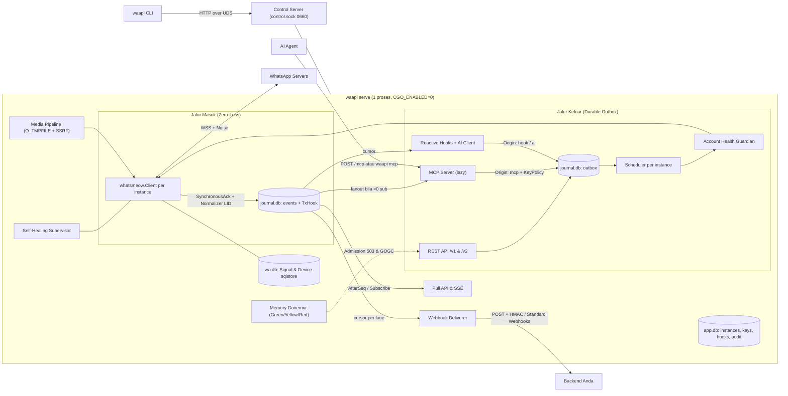

# ARCHITECTURE.md — `waapi` v2: Private WhatsApp API Gateway (Headless, Memori Rendah)

> **Status:** Terimplementasi (target `v2.0.0`, Go `1.27.0`, `CGO_ENABLED=0`) · **Binary:** tunggal & statis (`waapi`), dikendalikan via CLI `control.sock`.
> **Desain anggaran memori (profil default `lean`):** `GOMEMLIMIT=28MiB`, `MemoryHigh=56M`, `MemoryMax=80M`. Pengukuran runtime live ARM64 dicatat terpisah pada [bench/burnin-v2.0.0.md](bench/burnin-v2.0.0.md).

---

## 0. TL;DR Keputusan Arsitektur V2

| Aspek | Desain Final V2 |
|---|---|
| Bahasa / Protokol WA | **Go 1.27.0 (`CGO_ENABLED=0`) + `go.mau.fi/whatsmeow`** (WebSocket + Noise_XX + Signal Protocol) |
| Penyimpanan Multi-DB | **SQLite pure Go (`modernc.org/sqlite` v1.62.0)** terpisah menjadi 3 berkas: `app.db`, `journal.db`, dan `wa.db` |
| HTTP & MCP | `net/http` stdlib (Go 1.22+ pattern routing) + `github.com/modelcontextprotocol/go-sdk v1.8.0` (*lazy init*, stateless `2026-07-28`) |
| CLI ↔ Daemon | HTTP/1.1 di atas Unix Domain Socket `$WAAPI_DATA_DIR/control.sock` (dibuat atomik: listen `.tmp` -> `chmod 0660` -> `rename`) |
| Keamanan API & Rilis | `X-API-Key` / `Authorization: Bearer` (hash SHA-256), `scopes`, `KeyPolicy`, `audit_log` + `SO_PEERCRED`, update Ed25519 *fail-closed* |
| Jalur Masuk | `SynchronousAck=true` + `EnableDecryptedEventBuffer=true` -> transaksi tunggal `journal.db` + `TxHook` sebelum ack WhatsApp |
| Jalur Keluar | Durable Outbox SQLite (`POST /v2/.../messages` membalas `202`), lease recovery, **Account Health Guardian** |
| Media v2 | Streaming 1 pass melalui 1 temp file anonim (`O_TMPFILE` + drop-behind `4 MiB`), reuse `upload_id`, SSRF `netguard`, Media Resurrection |
| Memori & Observabilitas | **Memory Governor** (`Green`/`Yellow`/`Red` berbasis `Pss_Anon` + PSI), `runtime/metrics` (tanpa STW `ReadMemStats`), `procfs`, `sqlite.DBStatus`, `/metrics` opt-in |
| Fitur Opsional Zero-Cost | **Context Store FTS5**, **MCP Server**, **Reactive Hooks**, & **Native AI Responder** — tidak memakan RAM/goroutine sebelum diaktifkan |

---

## 1. Alur Arsitektur V2 (Satu Proses, Tiga Database)



### Pemisahan 3 Database SQLite

| Berkas DB | Lokasi & Sifat | Tabel Utama (`migrasi embed`) |
|---|---|---|
| `app.db` | Konfigurasi persisten, churn rendah, di-backup atomik via `VACUUM INTO` (`internal/store/migrations/`) | `instances` (`settings`, `paired_at`), `api_keys` (`scopes`, `expires_at`, `rate_per_sec`, `policy`), `audit_log`, `hooks` (`webhook_outbox` v1 dipertahankan kosong pasca-migrasi) |
| `journal.db` | Buffer transaksi churn tinggi + ringkas kerja (`internal/journal/migrations/`) | `events`, `cursors`, `webhook_dead`, `outbox`, `uploads`, `polls`, `poll_votes`, `contacts_seen`, `guardian_hourly`, `guardian_fanout`, `health_log`, `messages`/`chats`/`messages_fts`, `hook_runs` |
| `wa.db` | Milik eksklusif `whatsmeow/sqlstore` (kunci Signal, prekeys, sender keys, app state) | Seluruh tabel `whatsmeow_*` (metadata perangkat: `SetOSInfo("waapi", {1,0,0})`, `RequireFullSync = false`) |

---

## 2. Struktur Paket Kode Aktual

```text
waapi/
├── cmd/waapi/               # Entry point CLI + daemon
├── internal/
│   ├── ai/                  # Client Chat Completions kompatibel OpenAI tanpa tools + prompt budget
│   ├── auth/                # API key (X-API-Key/Bearer), scope, KeyPolicy, rate limit, audit_log
│   ├── cli/                 # Perintah terminal waapi (backup, hook, context, mcp, health, doctor, update Ed25519)
│   ├── config/              # Parsing env WAAPI_*, profil micro/lean/classic, SetMemoryLimit
│   ├── control/             # Control plane privat lewat UDS control.sock + pprof + /control/backup + /control/mcp
│   ├── ctxstore/            # Context Store opt-in & indeks pencarian FTS5 BM25
│   ├── daemon/              # Composition root: pre-v2 backup, startup, pruner, Governor, systemd watchdog
│   ├── governor/            # Pengukur anon/PSI & pengendali tekanan memori Green/Yellow/Red
│   ├── guardian/            # Skor kesehatan akun 0-100, consent ledger, quiet hours, warm-up
│   ├── hooks/               # Compiler rule deklaratif, engine per-instance, takeover LRU, Webhook Gate
│   ├── httpapi/             # Router HTTP publik /v1/*, /v2/*, /mcp, /healthz, /readyz
│   ├── idgen/               # Generator ID deterministik aman konkurensi
│   ├── jid/                 # Paket daun parser & normalizer JID penerima
│   ├── journal/             # SQLite event journal + cursor konsumen + pruner + TxHook
│   ├── logx/                # Logger slog + adapter log whatsmeow dengan rate limit per detik
│   ├── mcpserver/           # Server MCP stateless (2026-07-28 & 2025-11-25), 15 tool, 2 resource, MRTR HMAC
│   ├── media/               # Media Engine 1-pass (O_TMPFILE, drop-behind 4 MiB, Media Resurrection)
│   ├── netguard/            # Validasi IP anti-SSRF pasca resolusi DNS (RFC1918, CGNAT, NAT64, 6to4, loopback)
│   ├── obs/                 # Registry metrik Prometheus tulisan tangan, smaps_rollup, cgroup v2, PSI, DBStatus
│   ├── outbox/              # Antrean kirim persisten, scheduler per instance, idempotency, recovery lease
│   ├── policy/              # Penegakan KeyPolicy (reply_window, allowed_chats, first_contact, destructive, MRTR)
│   ├── sdnotify/            # Integrasi READY=1 / WATCHDOG=1 / STOPPING=1 ke systemd
│   ├── store/               # Akses app.db, migrasi embed di sqlite.go, InstanceSettings bertipe
│   ├── wa/                  # Pembungkus whatsmeow, Self-Healing Supervisor, Normalizer LID, Poll/Group/Call
│   └── webhook/             # Deliverer per lane berbasis cursor journal, HMAC waapi/standard, DLQ
├── tools/sign/              # CLI penandatangan rilis Ed25519 offline (checksums.txt.sig)
├── deploy/                  # install.sh (micro/lean/classic), update.sh, wa-api.service, Dockerfile
└── scripts/                 # burnin.sh, memprobe.sh, checklinks.sh
```

**Dependensi langsung utama (`go.mod`):** `go.mau.fi/whatsmeow`, `modernc.org/sqlite`, `github.com/modelcontextprotocol/go-sdk`, `github.com/google/jsonschema-go`, `github.com/mdp/qrterminal/v3`, `golang.org/x/sync`, `golang.org/x/sys`, `golang.org/x/time`, `google.golang.org/protobuf`, `rsc.io/qr`.

---

## 3. Strategi Pengendalian Memori & Keandalan

### 3.1 Tiga Profil Memori (`WAAPI_PROFILE`)

| Parameter | `micro` | `lean` (default) | `classic` |
|---|---|---|---|
| Fallback `GOMEMLIMIT` | `20 MiB` | `28 MiB` | `80 MiB` |
| `cache_size` app / journal / wa (KiB) | `256 / 512 / 1024` | `512 / 1024 / 2000` | `2000 / 2000 / 2000` |
| Budget anonim Governor (`WAAPI_MEMORY_BUDGET_MIB`) | `16 MiB` | `22 MiB` | `64 MiB` |
| systemd `MemoryHigh` / `MemoryMax` | `40M` / `64M` | `56M` / `80M` | `90M` / `100M` |
| Default `webhook_lanes` / `WAAPI_SSE_MAX` | `2` / `4` | `4` / `8` | `8` / `32` |

### 3.2 Tiga Lapis Pertahanan Memori

1. **Go Runtime:** `GOMEMLIMIT` per profil + `GOGC` dinamis (`50` normal, turun ke `25` saat Governor memasuki `Yellow`) dan `debug.FreeOSMemory()` dengan cooldown 60 detik pada transisi `Red` atau pasca-pairing.
2. **Aplikasi:** Antrean keluar-masuk tinggal di disk (`journal.db`), `O_TMPFILE` + `posix_fadvise`/`sync_file_range` drop-behind 4 MiB saat media upload, cache terikat (`LRU`), `PRAGMA shrink_memory` saat `Yellow`, dan penolakan cepat `503 memory_pressure` untuk request berat (`pair`, SSE, upload/unduh media) saat `Red`.
3. **OS / systemd:** `deploy/wa-api.service` menegakkan `MemorySwapMax=0`, `NoNewPrivileges=true`, `ProtectSystem=strict`, `ProtectHome=true`, `ReadWritePaths=/var/lib/waapi`, serta `SystemCallFilter`.

### 3.3 Reliabilitas Jalur Masuk, Keluar & Koneksi

- **Jalur Masuk:** Seluruh `InboundObserver` (receipt status outbox, vote polling, consent ledger STOP/START, serta Context Store FTS5) dieksekusi dalam transaksi SQLite `journal.db` yang sama **sebelum** `whatsmeow` mengirim ack ke WhatsApp.
- **Supervisor Koneksi:** `EnableAutoReconnect=false` & `InitialAutoReconnect=false` menyerahkan kontrol penuh kepada state machine `Supervisor` per instance dengan equal-jitter exponential backoff, circuit breaker (`>= 10` kegagalan), keepalive timeout `75s`, dan socket option `TCP_USER_TIMEOUT=45s`.
- **Backup & Integritas Data:** `waapi backup` memanggil `POST /control/backup` (`VACUUM INTO` konsisten untuk `app.db`, `journal.db`, `wa.db` tanpa mematikan daemon, izin `0600`, retensi 3 snapshot terbaru di `<DataDir>/backups/`), lalu menyalin ke `--out <dir>` dari proses CLI pemanggil apabila diinginkan. Detail mitigasi keamanan tersedia di [SECURITY.md](SECURITY.md).
