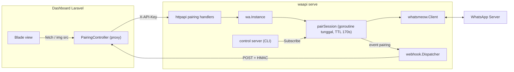
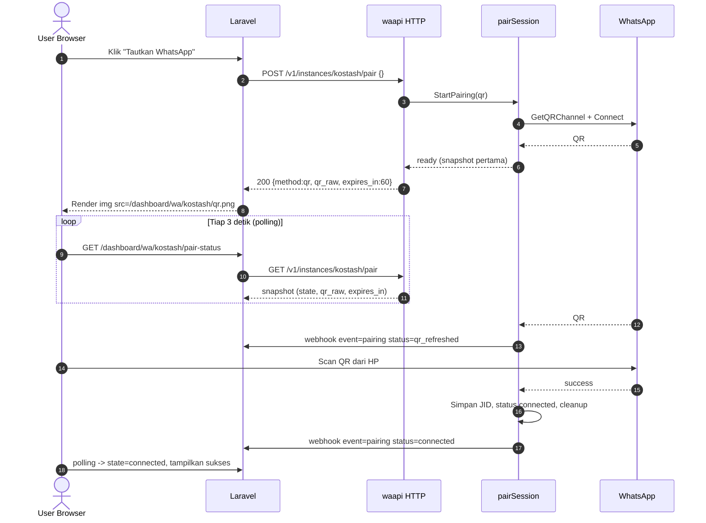
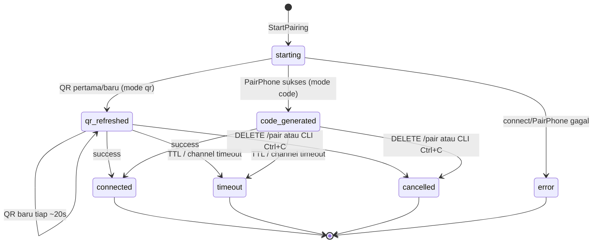

# PAIRING-API-SPEC.md — REST API Pairing per Instance (QR & 8-Digit Code)

> **Status:** Spesifikasi siap implementasi · **Target versi:** `v1.1.0`
> **Scope:** Pairing per-instance via `/v1/instances/{id}/pair*` untuk dashboard eksternal (mis. Laravel) tanpa CLI.
> **Constraint:** Zero regression RAM (`GOMEMLIMIT=80MiB`, `MemoryMax=100M`), zero goroutine leak.

---

## 1. Executive Summary & Architecture Flow

### 1.1 Masalah pada implementasi saat ini

`Instance.Pair(ctx, phone, emit)` di [`internal/wa/instance.go`](../internal/wa/instance.go) **terikat pada `ctx` request** milik stream NDJSON CLI. Model ini tidak cocok untuk REST:

| Masalah | Dampak jika dipakai langsung di REST |
|---|---|
| Lifetime pairing = lifetime request | Request `POST` harus menunggu sampai 160 detik (scan selesai) → timeout di proxy/Laravel |
| Tidak ada state yang bisa di-query | `GET qr.png` tidak punya sumber QR terbaru |
| `pairingSem.Acquire` blocking | Request kedua menggantung, bukan ditolak cepat |
| Tidak ada owner jelas saat browser ditutup | Pairing bisa terputus prematur, atau sebaliknya tidak pernah dibersihkan |

### 1.2 Solusi: `pairSession` detached dengan TTL keras

Pairing dipisah menjadi **sesi latar belakang per instance** yang:

1. Dimulai oleh `POST /pair` (atau CLI), **tidak** terikat ke `ctx` request.
2. Punya `context.WithTimeout` sendiri = **170 detik** (batas server WhatsApp ±160 detik + margin 10 detik).
3. Menyimpan snapshot terakhir (QR raw / pairing code / status) di memori — ukuran < 1 KB.
4. Bisa di-query (`GET /pair`, `GET /qr.png`) dan dibatalkan (`DELETE /pair`).
5. **Selalu** dibersihkan oleh `defer` tunggal: cancel ctx, release semaphore, disconnect client bila gagal, tutup semua subscriber.

Browser ditutup → **tidak berpengaruh** pada sesi; sesi mati sendiri pada TTL. Tidak ada goroutine yang hidup lebih lama dari 170 detik.

### 1.3 Arsitektur



### 1.4 Sequence: pairing QR dari dashboard



### 1.5 State machine `pairSession`



| State | Terminal | Keterangan |
|---|---|---|
| `starting` | Tidak | WebSocket sedang dibuka, belum ada QR/kode |
| `qr_refreshed` | Tidak | QR raw terbaru tersedia |
| `code_generated` | Tidak | Kode 8 digit tersedia |
| `connected` | Ya | Pairing sukses, JID tersimpan |
| `timeout` | Ya | TTL 170s habis / server menutup channel QR |
| `cancelled` | Ya | Dibatalkan manual |
| `error` | Ya | Gagal (mis. `PairPhone` ditolak, rate-overlimit) |

Snapshot terminal **dipertahankan di memori sampai `POST /pair` berikutnya** (bukan goroutine, hanya struct kecil), agar polling dashboard tetap bisa membaca hasil akhir.

---

## 2. HTTP API Contract

**Auth:** semua endpoint memakai `X-API-Key` + `withInstanceAuth` yang sudah ada (key global `*` atau key ter-scope ke `{id}`).

> [!IMPORTANT]
> Siapa pun yang memegang API key ter-scope ke instance dapat menautkan nomor WhatsApp ke instance itu. Untuk dashboard, gunakan key khusus per instance (`waapi key add --name dashboard --instance kostash`) dan **jangan pernah** mengirim key ke browser.

### 2.1 `POST /v1/instances/{id}/pair` — Mulai pairing

**Headers**

| Header | Wajib | Nilai |
|---|---|---|
| `X-API-Key` | Ya | `wak_...` |
| `Content-Type` | Jika ada body | `application/json` |

**Request body (opsional, maks 1 KB)**

| Field | Tipe | Wajib | Keterangan |
|---|---|---|---|
| `phone` | string | Tidak | Format internasional tanpa `+`, 8–15 digit, tidak boleh diawali `0`. Ada → mode `code`; kosong/tidak ada → mode `qr` |

Body kosong, `{}`, atau tanpa `Content-Type` → mode QR.

**Perilaku idempoten**

| Kondisi | Hasil |
|---|---|
| Tidak ada sesi aktif | Sesi baru dibuat, tunggu snapshot pertama (maks 15 detik) |
| Sesi aktif dengan method + phone sama | Kembalikan snapshot sesi yang sedang berjalan (tidak membuat sesi baru) |
| Sesi aktif dengan method/phone berbeda | `409 pairing_in_progress` |
| Instance sudah `connected` | `409 already_paired` |
| Instance lain sedang pairing | `409 pairing_busy` + `Retry-After` |

**Response `200 OK`**

```json
{
  "instance": "kostash",
  "method": "qr",
  "state": "qr_refreshed",
  "pairing_code": null,
  "qr_raw": "2@AbCdEf...,base64...,base64...,base64...",
  "qr_image_url": "/v1/instances/kostash/qr.png",
  "expires_in": 60,
  "session_expires_in": 168,
  "jid": null,
  "error": null
}
```

```json
{
  "instance": "kostash",
  "method": "code",
  "state": "code_generated",
  "pairing_code": "GKMW-A1DL",
  "qr_raw": null,
  "qr_image_url": null,
  "expires_in": 165,
  "session_expires_in": 165,
  "jid": null,
  "error": null
}
```

| Field | Keterangan |
|---|---|
| `method` | `qr` \| `code` |
| `state` | Lihat tabel state §1.5 |
| `pairing_code` | Kode 8 digit dengan format `XXXX-XXXX`, `null` pada mode QR |
| `qr_raw` | String mentah dari whatsmeow untuk render QR di frontend (mis. `qrcode.js`), `null` pada mode code |
| `qr_image_url` | Path relatif ke waapi; **harus di-proxy** oleh backend (butuh `X-API-Key`) |
| `expires_in` | Detik sampai QR saat ini kedaluwarsa (`QRChannelItem.Timeout` dikurangi waktu berlalu). Mode code = sisa umur sesi |
| `session_expires_in` | Detik sampai sesi pairing ditutup paksa (TTL 170s) |

### 2.2 `GET /v1/instances/{id}/pair` — Status pairing (polling)

Response `200` = snapshot terkini dengan bentuk identik §2.1. Jika belum pernah ada sesi: `404 no_pairing_session`.

Dashboard memanggil tiap **2–3 detik**. Biayanya hanya RLock + encode JSON < 1 KB.

### 2.3 `DELETE /v1/instances/{id}/pair` — Batalkan pairing

Response `200`: snapshot dengan `state: "cancelled"`. Tanpa sesi aktif: `404 no_active_pairing`.

### 2.4 `GET /v1/instances/{id}/qr.png` — Gambar QR

| Query | Tipe | Default | Batas | Keterangan |
|---|---|---|---|---|
| `scale` | int | `6` | 2–16 | Piksel per modul QR (QR WhatsApp ±53 modul → scale 6 ≈ 320 px) |

**Response `200`**

| Header | Nilai |
|---|---|
| `Content-Type` | `image/png` |
| `Cache-Control` | `no-store, max-age=0` |
| `X-QR-Expires-In` | Sisa detik QR saat ini |

Body: PNG mentah (±1–3 KB). Kondisi gagal: `404 qr_not_available` (sesi mode code, sesi terminal, atau QR belum tersedia).

**Generator QR:** `rsc.io/qr` — pure Go, **sudah ada di `go.sum`** sebagai dependensi transitif `qrterminal`, sehingga **tidak menambah ukuran binary**. Hasil PNG di-cache per pasangan `(qr_raw, scale)` di dalam sesi; polling berulang tidak meng-encode ulang.

> [!NOTE]
> `skip2/go-qrcode` juga pure Go, tetapi menambah modul baru. `rsc.io/qr` memberi hasil identik untuk kebutuhan ini dengan nol dependensi tambahan.

### 2.5 Error codes

Envelope mengikuti [`respond.go`](../internal/httpapi/respond.go): `{"error":{"code":"...","message":"...","retry_after":N}}`.

| HTTP | `error.code` | Kapan |
|---|---|---|
| 400 | `invalid_phone` | `phone` bukan 8–15 digit atau diawali `0` |
| 400 | `invalid_request` | Body bukan JSON valid / > 1 KB |
| 401 | `unauthorized` | Key salah/dicabut |
| 403 | `forbidden_instance` | Key ter-scope ke instance lain |
| 404 | `instance_not_found` | Instance tidak ada |
| 404 | `no_pairing_session` | `GET /pair` tanpa riwayat sesi |
| 404 | `no_active_pairing` | `DELETE /pair` tanpa sesi aktif |
| 404 | `qr_not_available` | `qr.png` saat tidak ada QR aktif |
| 409 | `already_paired` | Instance sudah tertaut; logout dulu |
| 409 | `pairing_in_progress` | Sesi aktif dengan method/phone berbeda |
| 409 | `pairing_busy` | Instance lain sedang pairing (`Retry-After: 10`) |
| 502 | `pairing_failed` | Connect/`PairPhone` gagal (detail di `message`) |
| 504 | `pairing_start_timeout` | QR/kode pertama tidak muncul dalam 15 detik |

### 2.6 Webhook event `pairing`

Dikirim lewat dispatcher yang sudah ada (HMAC, retry, outbox). Header `X-WA-Event: pairing`.

```json
{
  "event": "pairing",
  "instance": "kostash",
  "timestamp": 1794362000,
  "data": {
    "status": "qr_refreshed",
    "method": "qr",
    "qr_raw": "2@...",
    "pairing_code": null,
    "expires_in": 20,
    "jid": null,
    "error": null
  }
}
```

| `data.status` | Dipicu saat |
|---|---|
| `qr_refreshed` | Setiap QR baru (pertama 60s, selanjutnya ~20s) |
| `code_generated` | `PairPhone` mengembalikan kode |
| `connected` | Pairing sukses (`jid` terisi) |
| `timeout` | TTL habis / channel QR ditutup server |
| `cancelled` | `DELETE /pair` atau CLI dibatalkan |
| `error` | Gagal (`error` terisi) |

> [!WARNING]
> Default `webhook_events` instance adalah `message,receipt,connection`. Event `pairing` **tidak terkirim** sampai ditambahkan: `waapi edit kostash --events message,receipt,connection,pairing`. Default untuk instance baru di migrasi berikutnya diubah menjadi menyertakan `pairing`.

---

## 3. File-by-file Implementation Plan

Ringkasan perubahan:

| File | Aksi |
|---|---|
| `internal/wa/pairing.go` | **Baru** — `pairSession`, state, snapshot, subscriber, PNG cache |
| `internal/wa/instance.go` | Hapus `Pair()` lama, tambah `StartPairing`, `PairingSnapshot`, `CancelPairing`, field `pairing` |
| `internal/wa/manager.go` | `pairingSem` dipakai via `TryAcquire`; default events menyertakan `pairing` |
| `internal/httpapi/pairing.go` | **Baru** — 4 handler |
| `internal/httpapi/router.go` | Registrasi 4 route |
| `internal/httpapi/respond.go` | Mapping sentinel error pairing |
| `internal/control/stream.go` | CLI memakai `StartPairing` + `Subscribe` |
| `internal/store/migrations/0002_pairing_event.sql` | **Baru** — default `webhook_events` menyertakan `pairing` |
| `go.mod` | `rsc.io/qr` naik dari `// indirect` menjadi direct (otomatis via `go mod tidy`) |

### 3.1 `internal/wa/pairing.go` (baru)

```go
package wa

import (
	"context"
	"errors"
	"fmt"
	"strings"
	"sync"
	"time"

	"go.mau.fi/whatsmeow"
	"rsc.io/qr"
)

// Batas waktu sesi pairing: server WhatsApp menutup login websocket setelah ±160 detik
const (
	pairSessionTTL   = 170 * time.Second
	pairStartTimeout = 15 * time.Second
	pairSubBuffer    = 8
)

// Sentinel error pairing yang dipetakan ke kode HTTP di layer httpapi
var (
	ErrAlreadyPaired     = errors.New("instance sudah tertaut, logout terlebih dahulu")
	ErrPairingInProgress = errors.New("sesi pairing lain sedang berjalan pada instance ini")
	ErrPairingBusy       = errors.New("instance lain sedang melakukan pairing, coba lagi sebentar")
	ErrNoPairingSession  = errors.New("belum ada sesi pairing pada instance ini")
	ErrNoActivePairing   = errors.New("tidak ada sesi pairing aktif")
	ErrQRNotAvailable    = errors.New("QR code tidak tersedia")
	ErrInvalidPhone      = errors.New("nomor harus format internasional 8-15 digit tanpa awalan 0, contoh 6281234567890")
	ErrPairStartTimeout  = errors.New("QR/kode pairing pertama tidak muncul dalam batas waktu")
)

// PairMethod menentukan mode pairing
type PairMethod string

const (
	PairMethodQR   PairMethod = "qr"
	PairMethodCode PairMethod = "code"
)

// PairState adalah status sesi pairing
type PairState string

const (
	PairStarting      PairState = "starting"
	PairQRRefreshed   PairState = "qr_refreshed"
	PairCodeGenerated PairState = "code_generated"
	PairConnected     PairState = "connected"
	PairTimeout       PairState = "timeout"
	PairCancelled     PairState = "cancelled"
	PairError         PairState = "error"
)

// isTerminal menandakan state akhir yang tidak akan berubah lagi
func (s PairState) isTerminal() bool {
	return s == PairConnected || s == PairTimeout || s == PairCancelled || s == PairError
}

// PairSnapshot adalah representasi publik sesi pairing untuk HTTP, CLI, dan webhook
type PairSnapshot struct {
	Instance         string     `json:"instance"`
	Method           PairMethod `json:"method"`
	State            PairState  `json:"state"`
	PairingCode      *string    `json:"pairing_code"`
	QRRaw            *string    `json:"qr_raw"`
	QRImageURL       *string    `json:"qr_image_url"`
	ExpiresIn        int        `json:"expires_in"`
	SessionExpiresIn int        `json:"session_expires_in"`
	JID              *string    `json:"jid"`
	Error            *string    `json:"error"`
}

// pairSession menjalankan satu proses pairing di goroutine tunggal dengan TTL keras
type pairSession struct {
	inst   *Instance
	method PairMethod
	phone  string

	ctx    context.Context
	cancel context.CancelFunc

	mu           sync.RWMutex
	state        PairState
	qrRaw        string
	code         string
	jid          string
	errMsg       string
	qrExpiresAt  time.Time
	sessionEndAt time.Time
	cancelledBy  bool

	pngKey string // kunci cache: qrRaw + scale
	png    []byte

	subs map[chan PairSnapshot]struct{}

	ready     chan struct{} // ditutup saat snapshot pertama (QR/kode/terminal) tersedia
	readyOnce sync.Once
	done      chan struct{} // ditutup saat goroutine sesi selesai total
}

func newPairSession(inst *Instance, method PairMethod, phone string) *pairSession {
	// Context sengaja diturunkan dari Background agar tidak mati saat request HTTP selesai
	ctx, cancel := context.WithTimeout(context.Background(), pairSessionTTL)
	return &pairSession{
		inst:         inst,
		method:       method,
		phone:        phone,
		ctx:          ctx,
		cancel:       cancel,
		state:        PairStarting,
		sessionEndAt: time.Now().Add(pairSessionTTL),
		subs:         make(map[chan PairSnapshot]struct{}),
		ready:        make(chan struct{}),
		done:         make(chan struct{}),
	}
}

// active mengembalikan true selama goroutine sesi masih berjalan
func (s *pairSession) active() bool {
	select {
	case <-s.done:
		return false
	default:
		return true
	}
}

// Snapshot membaca state terkini secara thread-safe
func (s *pairSession) Snapshot() PairSnapshot {
	s.mu.RLock()
	defer s.mu.RUnlock()
	return s.snapshotLocked()
}

func (s *pairSession) snapshotLocked() PairSnapshot {
	now := time.Now()
	snap := PairSnapshot{
		Instance:         s.inst.id,
		Method:           s.method,
		State:            s.state,
		SessionExpiresIn: secondsUntil(now, s.sessionEndAt),
	}
	if s.state.isTerminal() {
		snap.SessionExpiresIn = 0
	}
	if s.method == PairMethodQR && s.qrRaw != "" && !s.state.isTerminal() {
		raw := s.qrRaw
		url := fmt.Sprintf("/v1/instances/%s/qr.png", s.inst.id)
		snap.QRRaw = &raw
		snap.QRImageURL = &url
		snap.ExpiresIn = secondsUntil(now, s.qrExpiresAt)
	}
	if s.method == PairMethodCode && s.code != "" && !s.state.isTerminal() {
		code := s.code
		snap.PairingCode = &code
		snap.ExpiresIn = snap.SessionExpiresIn
	}
	if s.jid != "" {
		jid := s.jid
		snap.JID = &jid
	}
	if s.errMsg != "" {
		msg := s.errMsg
		snap.Error = &msg
	}
	return snap
}

// WaitReady menunggu snapshot pertama tersedia atau timeout start terlampaui
func (s *pairSession) WaitReady(ctx context.Context) (PairSnapshot, error) {
	timer := time.NewTimer(pairStartTimeout)
	defer timer.Stop()
	select {
	case <-s.ready:
		return s.Snapshot(), nil
	case <-timer.C:
		return s.Snapshot(), ErrPairStartTimeout
	case <-ctx.Done():
		// Request HTTP dibatalkan klien; sesi tetap berjalan sampai TTL
		return s.Snapshot(), ctx.Err()
	}
}

// Cancel menghentikan sesi secara manual (DELETE /pair atau CLI Ctrl+C)
func (s *pairSession) Cancel() {
	s.mu.Lock()
	s.cancelledBy = true
	s.mu.Unlock()
	s.cancel()
}

// Subscribe mendaftarkan listener event; unsubscribe wajib dipanggil oleh pemanggil
func (s *pairSession) Subscribe() (<-chan PairSnapshot, func()) {
	ch := make(chan PairSnapshot, pairSubBuffer)
	s.mu.Lock()
	if !s.active() {
		// Sesi sudah selesai: kirim snapshot terakhir lalu tutup
		ch <- s.snapshotLocked()
		close(ch)
		s.mu.Unlock()
		return ch, func() {}
	}
	s.subs[ch] = struct{}{}
	ch <- s.snapshotLocked()
	s.mu.Unlock()

	var once sync.Once
	return ch, func() {
		once.Do(func() {
			s.mu.Lock()
			if _, ok := s.subs[ch]; ok {
				delete(s.subs, ch)
				close(ch)
			}
			s.mu.Unlock()
		})
	}
}

// update mengubah state di bawah lock lalu menyiarkan snapshot ke subscriber & webhook
func (s *pairSession) update(fn func()) {
	s.mu.Lock()
	fn()
	snap := s.snapshotLocked()
	for ch := range s.subs {
		// Non-blocking: subscriber lambat kehilangan event lama, bukan menahan goroutine sesi
		select {
		case ch <- snap:
		default:
		}
	}
	s.mu.Unlock()

	s.readyOnce.Do(func() { close(s.ready) })
	s.inst.mgr.webhook.Enqueue(s.inst.id, "pairing", webhookPairingData(snap))
}

// PNG mengembalikan gambar QR terkini dengan cache per (qrRaw, scale)
func (s *pairSession) PNG(scale int) ([]byte, int, error) {
	s.mu.RLock()
	raw, state, method := s.qrRaw, s.state, s.method
	expiresIn := secondsUntil(time.Now(), s.qrExpiresAt)
	key := fmt.Sprintf("%s|%d", raw, scale)
	if s.pngKey == key && s.png != nil {
		png := s.png
		s.mu.RUnlock()
		return png, expiresIn, nil
	}
	s.mu.RUnlock()

	if method != PairMethodQR || raw == "" || state.isTerminal() {
		return nil, 0, ErrQRNotAvailable
	}
	code, err := qr.Encode(raw, qr.M)
	if err != nil {
		return nil, 0, fmt.Errorf("encode QR: %w", err)
	}
	code.Scale = scale
	png := code.PNG()

	s.mu.Lock()
	// Simpan hanya jika QR belum berganti selama proses encode
	if s.qrRaw == raw {
		s.pngKey, s.png = key, png
	}
	s.mu.Unlock()
	return png, expiresIn, nil
}

// run adalah satu-satunya goroutine sesi; semua resource dilepas di defer
func (s *pairSession) run() {
	cli := (*whatsmeow.Client)(nil)
	success := false

	defer func() {
		s.cancel()
		if !success && cli != nil {
			cli.Disconnect()
			s.inst.restoreStatusAfterAbort(context.Background())
		}
		s.inst.mgr.pairingSem.Release(1)

		s.mu.Lock()
		for ch := range s.subs {
			close(ch)
		}
		s.subs = nil
		// Lepas cache PNG agar memori segera bisa di-GC
		s.png, s.pngKey = nil, ""
		s.mu.Unlock()

		s.readyOnce.Do(func() { close(s.ready) })
		close(s.done)
	}()

	dev, err := s.inst.resolveOrCreateDevice(s.ctx)
	if err != nil {
		s.fail(err)
		return
	}
	cli = s.inst.attachClient(dev)
	s.inst.setStatus(StatusPairing, "")
	_ = s.inst.mgr.store.UpdateInstanceStatus(s.ctx, s.inst.id, StatusPairing, "")

	qrChan, err := cli.GetQRChannel(s.ctx)
	if err != nil {
		s.fail(fmt.Errorf("buka QR channel: %w", err))
		return
	}
	if err := cli.Connect(); err != nil {
		s.fail(fmt.Errorf("connect untuk pairing: %w", err))
		return
	}

	codeRequested := false
	for {
		select {
		case <-s.ctx.Done():
			s.mu.RLock()
			manual := s.cancelledBy
			s.mu.RUnlock()
			if manual {
				s.update(func() { s.state = PairCancelled })
			} else {
				s.update(func() { s.state = PairTimeout })
			}
			return

		case item, ok := <-qrChan:
			if !ok {
				// Channel ditutup tanpa event terminal: anggap timeout
				s.update(func() { s.state = PairTimeout })
				return
			}
			switch {
			case item.Event == "code":
				if s.method == PairMethodQR {
					expiresAt := time.Now().Add(item.Timeout)
					s.update(func() {
						s.state = PairQRRefreshed
						s.qrRaw = item.Code
						s.qrExpiresAt = expiresAt
					})
					continue
				}
				if codeRequested {
					continue
				}
				codeRequested = true
				code, err := cli.PairPhone(s.ctx, s.phone, true, whatsmeow.PairClientChrome, "Chrome (Linux)")
				if err != nil {
					s.fail(fmt.Errorf("PairPhone: %w", err))
					return
				}
				s.update(func() {
					s.state = PairCodeGenerated
					s.code = code
				})

			case item == whatsmeow.QRChannelSuccess:
				jid := ""
				if cli.Store != nil && cli.Store.ID != nil {
					jid = cli.Store.ID.String()
				}
				success = true
				s.inst.setStatus(StatusConnected, jid)
				_ = s.inst.mgr.store.UpdateInstanceStatus(context.Background(), s.inst.id, StatusConnected, jid)
				s.update(func() {
					s.state = PairConnected
					s.jid = jid
				})
				return

			case item == whatsmeow.QRChannelTimeout:
				s.update(func() { s.state = PairTimeout })
				return

			case item.Event == "error" || strings.HasPrefix(item.Event, "err-"):
				msg := item.Event
				if item.Error != nil {
					msg = item.Error.Error()
				}
				s.fail(errors.New(msg))
				return
			}
		}
	}
}

func (s *pairSession) fail(err error) {
	s.update(func() {
		s.state = PairError
		s.errMsg = err.Error()
	})
}

func webhookPairingData(s PairSnapshot) map[string]any {
	return map[string]any{
		"status":       s.State,
		"method":       s.Method,
		"qr_raw":       s.QRRaw,
		"pairing_code": s.PairingCode,
		"expires_in":   s.ExpiresIn,
		"jid":          s.JID,
		"error":        s.Error,
	}
}

func secondsUntil(now, t time.Time) int {
	if t.IsZero() {
		return 0
	}
	d := int(t.Sub(now).Seconds())
	if d < 0 {
		return 0
	}
	return d
}

// normalizePairPhone memvalidasi nomor untuk mode pairing code
func normalizePairPhone(raw string) (string, error) {
	p := digitsOnly(raw)
	if len(p) < 8 || len(p) > 15 || strings.HasPrefix(p, "0") {
		return "", ErrInvalidPhone
	}
	return p, nil
}
```

> [!NOTE]
> `StatusPairing`, `StatusConnected` di atas merujuk ke konstanta `store.Status*`; saat implementasi gunakan `store.StatusPairing` dst. sesuai import yang ada di `instance.go`.

**Kenapa `update()` memanggil webhook di luar lock:** `Dispatcher.Enqueue` melakukan query SQLite (resolve target) — tidak boleh ditahan di bawah `s.mu` agar `GET /pair` tidak ikut tertahan oleh I/O disk.

**Kenapa `PNG()` encode di luar lock:** encode QR ±0.3 ms dan alokasi ±50–150 KB sementara; dilakukan tanpa lock agar polling `GET /pair` paralel tidak terblokir.

### 3.2 `internal/wa/instance.go`

**Tambahkan field** pada struct `Instance`:

```go
	// pairing menyimpan sesi pairing aktif atau sesi terminal terakhir (hanya snapshot kecil)
	pairMu  sync.Mutex
	pairing *pairSession
```

**Hapus** method `Pair(ctx, phone, emit)` lama beserta tipe `PairEvent` (digantikan `PairSnapshot`).

**Tambahkan** method publik:

```go
// StartPairing memulai sesi pairing baru atau mengembalikan sesi identik yang sedang berjalan
func (i *Instance) StartPairing(rawPhone string) (*pairSession, error) {
	method, phone := PairMethodQR, ""
	if strings.TrimSpace(rawPhone) != "" {
		p, err := normalizePairPhone(rawPhone)
		if err != nil {
			return nil, err
		}
		method, phone = PairMethodCode, p
	}

	if i.IsConnected() {
		return nil, ErrAlreadyPaired
	}

	i.pairMu.Lock()
	defer i.pairMu.Unlock()

	if cur := i.pairing; cur != nil && cur.active() {
		if cur.method == method && cur.phone == phone {
			return cur, nil
		}
		return nil, ErrPairingInProgress
	}

	// Tolak cepat alih-alih menunggu: request HTTP tidak boleh menggantung
	if !i.mgr.pairingSem.TryAcquire(1) {
		return nil, ErrPairingBusy
	}

	sess := newPairSession(i, method, phone)
	i.pairing = sess
	go sess.run()
	return sess, nil
}

// PairingSnapshot mengembalikan snapshot sesi terakhir (aktif maupun terminal)
func (i *Instance) PairingSnapshot() (PairSnapshot, error) {
	i.pairMu.Lock()
	sess := i.pairing
	i.pairMu.Unlock()
	if sess == nil {
		return PairSnapshot{}, ErrNoPairingSession
	}
	return sess.Snapshot(), nil
}

// PairingQRPNG mengembalikan PNG QR dari sesi aktif
func (i *Instance) PairingQRPNG(scale int) ([]byte, int, error) {
	i.pairMu.Lock()
	sess := i.pairing
	i.pairMu.Unlock()
	if sess == nil || !sess.active() {
		return nil, 0, ErrQRNotAvailable
	}
	return sess.PNG(scale)
}

// CancelPairing membatalkan sesi aktif dan menunggu goroutine sesi selesai (maks 5 detik)
func (i *Instance) CancelPairing() (PairSnapshot, error) {
	i.pairMu.Lock()
	sess := i.pairing
	i.pairMu.Unlock()
	if sess == nil || !sess.active() {
		return PairSnapshot{}, ErrNoActivePairing
	}
	sess.Cancel()
	select {
	case <-sess.done:
	case <-time.After(5 * time.Second):
	}
	return sess.Snapshot(), nil
}
```

**Ubah** `Close()` agar sesi pairing ikut dimatikan saat instance dihapus / daemon shutdown:

```go
// Close menghentikan sesi pairing, goroutine pengirim, dan koneksi WhatsApp
func (i *Instance) Close() {
	i.pairMu.Lock()
	sess := i.pairing
	i.pairMu.Unlock()
	if sess != nil && sess.active() {
		sess.Cancel()
		<-sess.done
	}
	if i.cancel != nil {
		i.cancel()
	}
	i.Disconnect()
}
```

**Ubah** `handleEvent` agar `events.Connected` saat sesi pairing aktif tidak mengirim dua webhook `connection` yang ambigu — cukup biarkan; event `connection` dan `pairing` memang berbeda kanal. Tidak ada perubahan.

### 3.3 `internal/wa/manager.go`

1. `pairingSem` tetap `semaphore.NewWeighted(1)`; seluruh pemakaian berubah ke `TryAcquire` (sudah di `StartPairing`). Release hanya di `pairSession.run()` defer — **satu-satunya** titik release.
2. Default `WebhookEvents` pada `Create`:

```go
		WebhookEvents: "message,receipt,connection,pairing",
```

3. `Delete` dan `Logout` memanggil `inst.CancelPairing()` (abaikan `ErrNoActivePairing`) sebelum logout, agar tidak ada sesi yang berebut device store.

### 3.4 `internal/store/migrations/0002_pairing_event.sql` (baru)

```sql
-- Tambahkan event pairing ke instance yang masih memakai default lama
UPDATE instances
SET webhook_events = webhook_events || ',pairing'
WHERE webhook_events = 'message,receipt,connection';
```

`CreateInstance` di `store/instances.go`: ubah default fallback menjadi `message,receipt,connection,pairing`.

### 3.5 `internal/httpapi/pairing.go` (baru)

```go
package httpapi

import (
	"encoding/json"
	"errors"
	"io"
	"net/http"
	"strconv"
	"strings"

	"github.com/fikfikk-org/waapi/internal/wa"
)

type startPairRequest struct {
	Phone string `json:"phone"`
}

// handleStartPair memulai sesi pairing dan mengembalikan QR/kode pertama
func (s *Server) handleStartPair(w http.ResponseWriter, r *http.Request, inst *wa.Instance) {
	var req startPairRequest
	r.Body = http.MaxBytesReader(w, r.Body, 1<<10)
	if err := json.NewDecoder(r.Body).Decode(&req); err != nil && !errors.Is(err, io.EOF) {
		writeError(w, http.StatusBadRequest, "invalid_request", "body harus JSON valid maksimal 1KB", 0)
		return
	}

	sess, err := inst.StartPairing(strings.TrimSpace(req.Phone))
	if err != nil {
		writePairingError(w, err)
		return
	}

	snap, err := sess.WaitReady(r.Context())
	if err != nil {
		if errors.Is(err, wa.ErrPairStartTimeout) {
			writeError(w, http.StatusGatewayTimeout, "pairing_start_timeout", err.Error(), 0)
			return
		}
		// Klien memutus koneksi; sesi tetap hidup sampai TTL, tidak perlu menulis response
		return
	}
	if snap.State == wa.PairError {
		msg := "pairing gagal"
		if snap.Error != nil {
			msg = *snap.Error
		}
		writeError(w, http.StatusBadGateway, "pairing_failed", msg, 0)
		return
	}
	writeJSON(w, http.StatusOK, snap)
}

// handleGetPair mengembalikan snapshot sesi pairing terkini untuk polling
func (s *Server) handleGetPair(w http.ResponseWriter, _ *http.Request, inst *wa.Instance) {
	snap, err := inst.PairingSnapshot()
	if err != nil {
		writePairingError(w, err)
		return
	}
	writeJSON(w, http.StatusOK, snap)
}

// handleCancelPair membatalkan sesi pairing aktif
func (s *Server) handleCancelPair(w http.ResponseWriter, _ *http.Request, inst *wa.Instance) {
	snap, err := inst.CancelPairing()
	if err != nil {
		writePairingError(w, err)
		return
	}
	writeJSON(w, http.StatusOK, snap)
}

// handleQRPNG mengirim gambar PNG QR aktif dengan cache-control no-store
func (s *Server) handleQRPNG(w http.ResponseWriter, r *http.Request, inst *wa.Instance) {
	scale := 6
	if v := r.URL.Query().Get("scale"); v != "" {
		n, err := strconv.Atoi(v)
		if err != nil || n < 2 || n > 16 {
			writeError(w, http.StatusBadRequest, "invalid_request", "scale harus 2-16", 0)
			return
		}
		scale = n
	}

	png, expiresIn, err := inst.PairingQRPNG(scale)
	if err != nil {
		writePairingError(w, err)
		return
	}
	w.Header().Set("Content-Type", "image/png")
	w.Header().Set("Cache-Control", "no-store, max-age=0")
	w.Header().Set("X-QR-Expires-In", strconv.Itoa(expiresIn))
	w.Header().Set("Content-Length", strconv.Itoa(len(png)))
	w.WriteHeader(http.StatusOK)
	_, _ = w.Write(png)
}

// writePairingError memetakan sentinel error pairing ke kode HTTP
func writePairingError(w http.ResponseWriter, err error) {
	switch {
	case errors.Is(err, wa.ErrInvalidPhone):
		writeError(w, http.StatusBadRequest, "invalid_phone", err.Error(), 0)
	case errors.Is(err, wa.ErrAlreadyPaired):
		writeError(w, http.StatusConflict, "already_paired", err.Error(), 0)
	case errors.Is(err, wa.ErrPairingInProgress):
		writeError(w, http.StatusConflict, "pairing_in_progress", err.Error(), 0)
	case errors.Is(err, wa.ErrPairingBusy):
		writeError(w, http.StatusConflict, "pairing_busy", err.Error(), 10)
	case errors.Is(err, wa.ErrNoPairingSession):
		writeError(w, http.StatusNotFound, "no_pairing_session", err.Error(), 0)
	case errors.Is(err, wa.ErrNoActivePairing):
		writeError(w, http.StatusNotFound, "no_active_pairing", err.Error(), 0)
	case errors.Is(err, wa.ErrQRNotAvailable):
		writeError(w, http.StatusNotFound, "qr_not_available", err.Error(), 0)
	default:
		writeError(w, http.StatusBadGateway, "pairing_failed", err.Error(), 0)
	}
}
```

### 3.6 `internal/httpapi/router.go`

Tambahkan di `NewHandler` setelah route instance yang ada:

```go
	// Pairing per instance (QR & 8-digit code) untuk dashboard eksternal
	mux.HandleFunc("POST /v1/instances/{id}/pair", s.withInstanceAuth(s.handleStartPair))
	mux.HandleFunc("GET /v1/instances/{id}/pair", s.withInstanceAuth(s.handleGetPair))
	mux.HandleFunc("DELETE /v1/instances/{id}/pair", s.withInstanceAuth(s.handleCancelPair))
	mux.HandleFunc("GET /v1/instances/{id}/qr.png", s.withInstanceAuth(s.handleQRPNG))
```

> [!WARNING]
> `WriteTimeout` server publik = 90 detik. `POST /pair` hanya menunggu maks 15 detik (`pairStartTimeout`), jadi aman. Jangan pernah menunggu sampai scan selesai di dalam handler.

### 3.7 `internal/control/stream.go` — CLI memakai mesin yang sama

CLI tetap streaming NDJSON, tetapi sumbernya `Subscribe()`. Perbedaan kebijakan: **CLI adalah pemilik sesi** — jika operator menekan Ctrl+C, sesi dibatalkan.

```go
// handlePairInstance mengalirkan snapshot pairing sebagai NDJSON ke CLI
func (s *Server) handlePairInstance(w http.ResponseWriter, r *http.Request) {
	inst, ok := s.wa.Get(r.PathValue("id"))
	if !ok {
		writeErr(w, http.StatusNotFound, ErrInstanceNotFound)
		return
	}
	var req pairReq
	_ = json.NewDecoder(r.Body).Decode(&req)

	sess, err := inst.StartPairing(req.Phone)
	if err != nil {
		writeErr(w, http.StatusConflict, err)
		return
	}

	flusher, ok := w.(http.Flusher)
	if !ok {
		writeErr(w, http.StatusInternalServerError, ErrStreamingUnsupported)
		return
	}
	w.Header().Set("Content-Type", "application/x-ndjson; charset=utf-8")
	w.WriteHeader(http.StatusOK)

	events, unsubscribe := sess.Subscribe()
	defer unsubscribe()

	enc := json.NewEncoder(w)
	for {
		select {
		case <-r.Context().Done():
			// Operator menekan Ctrl+C: CLI adalah pemilik sesi, batalkan pairing
			sess.Cancel()
			return
		case snap, ok := <-events:
			if !ok {
				return
			}
			_ = enc.Encode(snap)
			flusher.Flush()
		}
	}
}
```

`internal/cli/instance.go` (`runInstancePair`) menyesuaikan decode dari `wa.PairEvent` ke `wa.PairSnapshot`:

| `snap.State` | Aksi CLI |
|---|---|
| `qr_refreshed` | `renderQR(*snap.QRRaw)` |
| `code_generated` | Cetak `*snap.PairingCode` |
| `connected` | `✔ Terhubung sebagai *snap.JID` |
| `timeout` / `error` | Kembalikan error |
| `cancelled` | `Pairing dibatalkan.` |

Snapshot dengan `qr_raw` yang sama dengan sebelumnya di-skip agar QR tidak dicetak ulang.

### 3.8 Analisis memori (zero regression)

| Item | Biaya | Lifetime |
|---|---|---|
| `pairSession` struct + snapshot | < 1 KB | Sampai `POST /pair` berikutnya |
| Goroutine `run()` | ~8 KB stack | Maks 170 detik |
| Goroutine internal whatsmeow (QR emitter, websocket) | ~3–5 MB (sama seperti pairing via CLI saat ini) | Maks 170 detik, lalu `Disconnect` |
| Cache PNG | ~1–3 KB per scale aktif (hanya 1 disimpan) | Dibebaskan di `defer` |
| Encode QR sementara | ~50–150 KB transient | Langsung GC |
| Subscriber channel | 8 slot × ~200 B | Selama CLI streaming |

Semaphore global `pairingSem = 1` tetap menjamin **hanya satu** spike app-state sync awal per proses. Tidak ada perubahan pada budget di `ARCHITECTURE.md` §4.1.

### 3.9 Jaminan zero goroutine leak

| Skenario | Mekanisme |
|---|---|
| Browser ditutup saat pairing | Sesi tidak terikat request; `context.WithTimeout(170s)` memaksa selesai |
| `POST /pair` dibatalkan klien sebelum QR pertama | `WaitReady` keluar via `ctx.Done()`; sesi tetap terikat TTL |
| Polling berhenti total | Tidak ada goroutine per-poll; `GET` hanya baca snapshot |
| Subscriber CLI lambat | `update()` non-blocking send; tidak menahan `run()` |
| Subscriber lupa unsubscribe | `run()` defer menutup semua channel subscriber |
| Instance dihapus saat pairing | `Close()` → `Cancel()` → tunggu `done` |
| Daemon SIGTERM | `Manager.Close()` → `Instance.Close()` → sesi dibatalkan dan ditunggu |
| whatsmeow channel ditutup tanpa event | Branch `!ok` → state `timeout` → return |
| `PairPhone` menggantung | Memakai `s.ctx` dengan TTL yang sama |

---

## 4. Contoh Integrasi Client

### 4.1 cURL

```bash
API="http://127.0.0.1:8085"
KEY="wak_xxx"

# Mulai pairing mode QR
curl -s -X POST "$API/v1/instances/kostash/pair" -H "X-API-Key: $KEY"

# Mulai pairing mode 8-digit code
curl -s -X POST "$API/v1/instances/kostash/pair" \
  -H "X-API-Key: $KEY" -H "Content-Type: application/json" \
  -d '{"phone":"6281315793349"}'

# Polling status
curl -s "$API/v1/instances/kostash/pair" -H "X-API-Key: $KEY"

# Simpan gambar QR
curl -s "$API/v1/instances/kostash/qr.png?scale=8" -H "X-API-Key: $KEY" -o qr.png

# Batalkan pairing
curl -s -X DELETE "$API/v1/instances/kostash/pair" -H "X-API-Key: $KEY"

# Aktifkan event webhook pairing untuk instance lama
waapi edit kostash --events message,receipt,connection,pairing
```

### 4.2 Laravel — konfigurasi

```php
// config/services.php
'waapi' => [
    'url' => env('WAAPI_URL', 'http://127.0.0.1:8085'),
    'key' => env('WAAPI_KEY'),
    'webhook_secret' => env('WAAPI_WEBHOOK_SECRET'),
],
```

```dotenv
WAAPI_URL=http://127.0.0.1:8085
WAAPI_KEY=wak_xxx
WAAPI_WEBHOOK_SECRET=whsec_xxx
```

> [!IMPORTANT]
> `` di browser **tidak bisa** mengirim header `X-API-Key`. Karena itu QR wajib di-proxy lewat route Laravel yang dilindungi session/auth dashboard. API key tidak pernah keluar dari server Laravel.

### 4.3 Laravel — routes

```php
// routes/web.php
use App\Http\Controllers\WaPairingController;

Route::middleware(['auth'])->prefix('dashboard/wa/{instance}')->group(function () {
    Route::post('pair', [WaPairingController::class, 'start'])->name('wa.pair.start');
    Route::get('pair', [WaPairingController::class, 'status'])->name('wa.pair.status');
    Route::delete('pair', [WaPairingController::class, 'cancel'])->name('wa.pair.cancel');
    Route::get('qr.png', [WaPairingController::class, 'qr'])->name('wa.pair.qr');
});

// routes/api.php (tanpa CSRF) untuk webhook dari waapi
Route::post('webhook/waapi', [WaPairingController::class, 'webhook']);
```

### 4.4 Laravel — controller

```php
<?php

namespace App\Http\Controllers;

use Illuminate\Http\Client\ConnectionException;
use Illuminate\Http\Client\PendingRequest;
use Illuminate\Http\JsonResponse;
use Illuminate\Http\Request;
use Illuminate\Http\Response;
use Illuminate\Support\Facades\Http;
use Illuminate\Support\Facades\Log;

class WaPairingController extends Controller
{
    // Instance yang boleh dikelola dashboard ini; selaraskan dengan scope API key
    private const ALLOWED_INSTANCES = ['kostash'];

    private function client(): PendingRequest
    {
        return Http::baseUrl(config('services.waapi.url'))
            ->withHeaders(['X-API-Key' => config('services.waapi.key')])
            ->acceptJson()
            ->timeout(20);
    }

    private function guard(string $instance): void
    {
        abort_unless(in_array($instance, self::ALLOWED_INSTANCES, true), 404);
    }

    public function start(Request $request, string $instance): JsonResponse
    {
        $this->guard($instance);
        $data = $request->validate([
            // Wajib kode negara, tanpa awalan 0
            'phone' => ['nullable', 'regex:/^[1-9][0-9]{7,14}$/'],
        ]);

        try {
            $res = $this->client()->post(
                "/v1/instances/{$instance}/pair",
                array_filter(['phone' => $data['phone'] ?? null])
            );
        } catch (ConnectionException $e) {
            Log::error('waapi tidak dapat dihubungi', ['error' => $e->getMessage()]);
            return response()->json(['message' => 'Layanan WhatsApp tidak tersedia'], 503);
        }

        $body = $res->json() ?? [];
        // Ganti URL QR internal waapi dengan URL proxy dashboard
        if (! empty($body['qr_image_url'])) {
            $body['qr_image_url'] = route('wa.pair.qr', $instance);
        }
        return response()->json($body, $res->status());
    }

    public function status(string $instance): JsonResponse
    {
        $this->guard($instance);
        try {
            $res = $this->client()->get("/v1/instances/{$instance}/pair");
        } catch (ConnectionException $e) {
            return response()->json(['message' => 'Layanan WhatsApp tidak tersedia'], 503);
        }

        $body = $res->json() ?? [];
        if (! empty($body['qr_image_url'])) {
            $body['qr_image_url'] = route('wa.pair.qr', $instance);
        }
        return response()->json($body, $res->status());
    }

    public function cancel(string $instance): JsonResponse
    {
        $this->guard($instance);
        try {
            $res = $this->client()->delete("/v1/instances/{$instance}/pair");
        } catch (ConnectionException $e) {
            return response()->json(['message' => 'Layanan WhatsApp tidak tersedia'], 503);
        }
        return response()->json($res->json() ?? [], $res->status());
    }

    public function qr(Request $request, string $instance): Response
    {
        $this->guard($instance);
        try {
            $res = $this->client()
                ->withHeaders(['Accept' => 'image/png'])
                ->get("/v1/instances/{$instance}/qr.png", ['scale' => 6]);
        } catch (ConnectionException $e) {
            abort(503);
        }

        abort_unless($res->successful(), $res->status());

        return response($res->body(), 200, [
            'Content-Type' => 'image/png',
            'Cache-Control' => 'no-store, max-age=0',
            'X-QR-Expires-In' => $res->header('X-QR-Expires-In'),
        ]);
    }

    public function webhook(Request $request): JsonResponse
    {
        $raw = $request->getContent();
        $ts = (string) $request->header('X-WA-Timestamp');
        $sig = (string) $request->header('X-WA-Signature');
        $expected = 'sha256=' . hash_hmac('sha256', $ts . '.' . $raw, config('services.waapi.webhook_secret'));

        // Tolak signature salah atau timestamp lebih dari 5 menit (anti-replay)
        if (! hash_equals($expected, $sig) || abs(time() - (int) $ts) > 300) {
            return response()->json(['message' => 'invalid signature'], 401);
        }

        $payload = $request->json()->all();
        if (($payload['event'] ?? null) === 'pairing') {
            // Contoh: broadcast ke dashboard via Laravel Echo / simpan status
            Log::info('waapi pairing event', [
                'instance' => $payload['instance'] ?? null,
                'status' => $payload['data']['status'] ?? null,
                'jid' => $payload['data']['jid'] ?? null,
            ]);
        }

        // Balas cepat (< 10 detik) agar waapi tidak melakukan retry
        return response()->json(['ok' => true]);
    }
}
```

> [!NOTE]
> `webhook_secret` per instance tidak ditampilkan di CLI saat ini. Tambahkan output secret pada `waapi show <id> --secret` (perubahan kecil di `control/server.go` + `cli/instance.go`) atau rotasi via `waapi edit <id> --rotate-secret` yang mencetak secret baru satu kali.

### 4.5 Blade + JavaScript (polling)

```blade
<div id="wa-pair">
    <button id="btn-qr">Tautkan via QR</button>
    <input id="phone" placeholder="6281234567890">
    <button id="btn-code">Tautkan via Kode</button>
    <button id="btn-cancel" hidden>Batal</button>

    
    <p id="code" hidden></p>
    <p id="status"></p>
</div>

<script>
const base = @json(url("dashboard/wa/kostash"));
const csrf = @json(csrf_token());
let timer = null;
let lastQR = null;

async function call(method, path = '', body = null) {
    const res = await fetch(`${base}/pair${path}`, {
        method,
        headers: { 'Content-Type': 'application/json', 'X-CSRF-TOKEN': csrf, 'Accept': 'application/json' },
        body: body ? JSON.stringify(body) : null,
    });
    return { ok: res.ok, status: res.status, data: await res.json().catch(() => ({})) };
}

function render(s) {
    const qr = document.getElementById('qr');
    const code = document.getElementById('code');
    document.getElementById('status').textContent = `Status: ${s.state ?? '-'}`;
    document.getElementById('btn-cancel').hidden = ['connected', 'timeout', 'cancelled', 'error'].includes(s.state);

    if (s.qr_raw && s.qr_raw !== lastQR) {
        // Cache-buster agar browser selalu mengambil QR terbaru
        qr.src = `${base}/qr.png?t=${Date.now()}`;
        lastQR = s.qr_raw;
    }
    qr.hidden = !s.qr_raw;
    code.hidden = !s.pairing_code;
    code.textContent = s.pairing_code ? `Kode: ${s.pairing_code}` : '';

    if (['connected', 'timeout', 'cancelled', 'error'].includes(s.state)) {
        clearInterval(timer);
        timer = null;
    }
}

async function start(body) {
    const r = await call('POST', '', body);
    if (!r.ok) {
        document.getElementById('status').textContent = r.data?.error?.message ?? 'Gagal memulai pairing';
        return;
    }
    render(r.data);
    clearInterval(timer);
    timer = setInterval(async () => {
        const s = await call('GET');
        if (s.ok) render(s.data);
    }, 3000);
}

document.getElementById('btn-qr').onclick = () => start(null);
document.getElementById('btn-code').onclick = () => start({ phone: document.getElementById('phone').value.trim() });
document.getElementById('btn-cancel').onclick = async () => render((await call('DELETE')).data);
</script>
```

Menutup tab hanya menghentikan polling; sesi di waapi berakhir otomatis paling lambat 170 detik.

---

## 5. Testing Plan & Zero-Leak Verification

### 5.1 Testability: injeksi sumber QR

Agar `pairSession.run()` bisa diuji tanpa server WhatsApp, abstraksikan tiga operasi whatsmeow di balik interface kecil yang hanya dipakai di sini:

```go
// pairDriver mengabstraksi operasi whatsmeow yang dibutuhkan sesi pairing (diganti fake saat test)
type pairDriver interface {
	QRChannel(ctx context.Context) (<-chan whatsmeow.QRChannelItem, error)
	Connect() error
	PairPhone(ctx context.Context, phone string) (string, error)
	Disconnect()
	JID() string
}
```

Implementasi produksi membungkus `*whatsmeow.Client`; test memakai `fakeDriver` yang mengirim item ke channel buatan sendiri.

### 5.2 Unit test (`internal/wa/pairing_test.go`)

| Test | Skenario | Assertion |
|---|---|---|
| `TestPairQRRefreshAndSuccess` | Fake kirim `code` ×2 lalu `success` | State `qr_refreshed` → `connected`, `qr_raw` = code terakhir, semaphore terlepas |
| `TestPairCodeMode` | Mode phone, fake kirim `code` | `PairPhone` dipanggil **tepat sekali**, state `code_generated`, `qr_raw` null |
| `TestPairTimeoutTTL` | TTL di-override 200ms, fake tidak pernah success | State `timeout`, `done` tertutup < 1s |
| `TestPairCancel` | `CancelPairing()` saat aktif | State `cancelled`, `Disconnect` dipanggil |
| `TestPairChannelClosed` | Fake menutup channel tanpa event | State `timeout` |
| `TestPairIdempotent` | `StartPairing("")` dua kali | Pointer sesi sama |
| `TestPairInProgressConflict` | QR aktif lalu `StartPairing("62812...")` | `ErrPairingInProgress` |
| `TestPairBusyAcrossInstances` | Instance A aktif, B mulai | `ErrPairingBusy` tanpa blocking (selesai < 10ms) |
| `TestPairInvalidPhone` | `0812...`, `123` | `ErrInvalidPhone` |
| `TestPNGCache` | `PNG(6)` dua kali, lalu QR berganti | Panggilan kedua mengembalikan slice identik; setelah QR baru hasil berbeda |
| `TestSubscriberSlowNonBlocking` | Subscriber tidak membaca, fake kirim 50 QR | `run()` tetap selesai, tidak deadlock |

TTL & start timeout dibuat `var` (bukan `const`) di level package agar test bisa meng-override:

```go
// Variabel (bukan konstanta) agar bisa dipersingkat saat test
var (
	pairSessionTTL   = 170 * time.Second
	pairStartTimeout = 15 * time.Second
)
```

### 5.3 Goroutine leak test

Gunakan `go.uber.org/goleak` (dependensi **test-only**, tidak masuk binary):

```go
// TestMain memastikan seluruh test package wa tidak meninggalkan goroutine
func TestMain(m *testing.M) {
	goleak.VerifyTestMain(m)
}
```

Setiap test di §5.2 otomatis gagal jika ada goroutine `pairSession.run`, subscriber, atau timer yang tersisa.

### 5.4 HTTP handler test (`internal/httpapi/pairing_test.go`)

| Test | Assertion |
|---|---|
| `POST /pair` tanpa key | `401 unauthorized` |
| `POST /pair` key scope instance lain | `403 forbidden_instance` |
| `POST /pair` body `{"phone":"0812"}` | `400 invalid_phone` |
| `POST /pair` body > 1KB | `400 invalid_request` |
| `GET /pair` sebelum ada sesi | `404 no_pairing_session` |
| `GET /qr.png` mode code | `404 qr_not_available` |
| `GET /qr.png?scale=99` | `400 invalid_request` |
| `GET /qr.png` sukses | `Content-Type: image/png`, 8 byte awal = signature PNG `\x89PNG\r\n\x1a\n`, `Cache-Control: no-store` |
| `DELETE /pair` tanpa sesi aktif | `404 no_active_pairing` |

### 5.5 Race detector

```bash
go test -race -count=3 ./internal/wa/... ./internal/httpapi/...
```

Wajib lolos: akses paralel `Snapshot()`, `PNG()`, `Subscribe()`, dan `update()` dari goroutine sesi.

### 5.6 Verifikasi manual di server (Armbian / VPS)

```bash
# 1. Baseline
waapi status | grep -E "RSS|Goroutines"

# 2. Mulai pairing lalu tinggalkan (simulasi browser ditutup)
curl -s -X POST http://127.0.0.1:8085/v1/instances/kostash/pair -H "X-API-Key: $KEY"
waapi status | grep -E "RSS|Goroutines"     # goroutine naik (whatsmeow websocket + sesi)

# 3. Tunggu TTL habis
sleep 180
waapi status | grep -E "RSS|Goroutines"     # goroutine kembali ke baseline (±2)
curl -s http://127.0.0.1:8085/v1/instances/kostash/pair -H "X-API-Key: $KEY"   # state=timeout

# 4. Stress: 50x POST+DELETE berurutan
for i in $(seq 1 50); do
  curl -s -o /dev/null -X POST   http://127.0.0.1:8085/v1/instances/kostash/pair -H "X-API-Key: $KEY"
  curl -s -o /dev/null -X DELETE http://127.0.0.1:8085/v1/instances/kostash/pair -H "X-API-Key: $KEY"
done
sleep 10
waapi status | grep -E "RSS|Goroutines"     # goroutine = baseline, RSS < baseline + 5 MB

# 5. Batas memori cgroup tidak terlampaui
systemctl show waapi -p MemoryPeak
```

> [!CAUTION]
> Langkah 4 membuka banyak koneksi login ke server WhatsApp dalam waktu singkat. Jalankan **hanya** pada instance uji tanpa nomor produksi, dan pakai mode QR (bukan `phone`) — `PairPhone` berulang dapat memicu `rate-overlimit` dari WhatsApp untuk nomor tersebut.

### 5.7 Kriteria selesai

| Kriteria | Target |
|---|---|
| Unit + handler test | 100% lulus dengan `-race` |
| goleak | Nol goroutine tersisa |
| Goroutine setelah TTL | Kembali ke baseline ±2 |
| RSS setelah stress 50 siklus | < baseline + 5 MB |
| `MemoryPeak` cgroup selama pairing | < 60 MB |
| Pairing nyata QR & code | `connected` dan instance auto-reconnect setelah `systemctl restart waapi` |
| CLI `waapi pair` | Tetap berfungsi dengan mesin baru; Ctrl+C → `cancelled` |

---

## 6. Known Pitfalls

| Pitfall | Mitigasi |
|---|---|
| `` tidak bisa kirim `X-API-Key` | Proxy via Laravel (§4.4) |
| Nomor diawali `0` (format lokal) | Ditolak `invalid_phone`; validasi juga di Laravel |
| `PairPhone` berulang → `rate-overlimit` | Idempoten: `POST` ulang dengan phone sama mengembalikan sesi berjalan, tidak memanggil `PairPhone` lagi |
| QR pertama berlaku 60 detik, berikutnya ~20 detik | Gunakan `expires_in` dari response, bukan angka tetap |
| Event `pairing` tidak sampai ke webhook | Tambahkan `pairing` ke `--events` instance lama (§2.6) |
| Pairing ulang saat instance `connected` | `409 already_paired`; jalankan `waapi logout <id>` dulu |
| `resolveOrCreateDevice` menghapus device lama | Hanya dipanggil setelah cek `IsConnected()` false; instance `logged_out` memang perlu device baru |
| Reverse proxy (Nginx) timeout < 15 detik | Set `proxy_read_timeout 30s` untuk path `/v1/instances/*/pair` |
