# Dokumentasi Business Logic — wa-api

> Status: terimplementasi (`cmd/waapi`, `internal/*`). Sumber: [ARCHITECTURE.md](ARCHITECTURE.md).

## Lifecycle Entitas

```mermaid
flowchart TD
    subgraph Instance
        C["created"] -->|"instance pair"| P["pairing"]
        P -->|"pairing sukses"| CN["connected"]
        P -->|"timeout / batal"| C
        CN -->|"koneksi putus"| D["disconnected"]
        D -->|"reconnect otomatis"| CN
        CN -->|"logout / unlink dari HP"| L["logged_out"]
        D -->|"logout"| L
        L -->|"pair ulang"| P
        CN -->|"instance stop"| DS["disabled"]
        DS -->|"instance restart"| CN
    end
    subgraph Supervisor
        SI["idle"] -->|"Start()"| SC["connecting"]
        PA["PairSession sukses"] -->|"Adopt()"| SO["online"]
        SC -->|"events.Connected / AlreadyConnected"| SO
        SC -->|"gagal / ConnectTimeout 30s"| SB["backoff"]
        SO -->|"KeepAliveTimeout &lt; KeepAliveMaxFail"| SD["degraded"]
        SD -->|"KeepAliveRestored"| SO
        SD -->|"KeepAliveTimeout &gt;= KeepAliveMaxFail"| SB
        SO -->|"events.Disconnected"| SB
        SB -->|"timer backoff (+ circuit 15m &gt;= 10x)"| SC
        SO -->|"TemporaryBan"| SBT["banned_temp"]
        SBT -->|"Expire + jitter 30-120s"| SC
        SO -->|"StreamReplaced"| SR["replaced"]
        SO -->|"LoggedOut reason lain"| SLO["logged_out"]
        SO -->|"LoggedOut 406"| SBN["banned"]
        SO -->|"ClientOutdated"| SOUT["outdated"]
        SC -->|"Stop()"| SST["stopped"]
        SB -->|"Stop()"| SST
    end
    subgraph ApiKey
        KA["active"] -->|"key revoke"| KR["revoked"]
    end
    subgraph WebhookEvent
        E1["journal.db (cursor lane)"] -->|"2xx"| E2["cursor commit"]
        E1 -->|"408/425/429/5xx atau network (<= max_attempts)"| E3["backoff / Retry-After"]
        E3 --> E1
        E1 -->|"habis retry / 4xx non-410 (<= 3x)"| E4["webhook_dead (DLQ)"]
        E4 -->|"webhook dlq replay 2xx"| E2
        E4 -->|"webhook dlq purge"| E5["dihapus"]
        E1 -->|"410 Gone"| E6["paused (gone)"]
        E6 -->|"webhook resume"| E1
    end
    subgraph Outbox
        O1["queued (outbox)"] -->|"klaim scheduler (ready & token tersedia)"| O2["sending (lease)"]
        O2 -->|"kirim sukses"| O3["sent"]
        O2 -->|"gagal transien & belum expired"| O1
        O2 -->|"gagal permanen / policy ditolak"| O4["failed"]
        O1 -->|"melewati expire_at"| O5["expired"]
        O2 -->|"melewati expire_at"| O5
        O1 -->|"dibatalkan klien"| O6["cancelled"]
        O3 -->|"receipt delivery (DM)"| O7["delivered"]
        O7 -->|"receipt read/played (DM)"| O8["read"]
    end
    subgraph MediaUpload
        M1["POST /v2/media (stream)"] -->|"sniff 64KiB + O_TMPFILE + drop-behind"| M2["active (uploads, TTL 24h)"]
        M2 -->|"kirim outbox berkali-kali"| M3["reused oleh banyak penerima"]
        M2 -->|"lewat 24h"| M4["expired (ditolak 410)"]
        M4 -->|"pruner tiap jam"| M5["dihapus"]
    end
    subgraph PollLifecycle
        PL1["Poll Creation (masuk TxHook / keluar pra-SendMessage)"] -->|"tersimpan di polls"| PL2["active (polls)"]
        PL2 -->|"PollUpdateMessage -> DecryptPollVote + SHA-256"| PL3["poll_votes di-upsert + event poll_vote"]
        PL3 -->|"pemilih ubah pilihan / unvote []"| PL3
    end
    subgraph CallAutoReject
        CA1["CallOffer masuk"] -->|"hot path journal"| CA2["event call action=offer"]
        CA1 -->|"auto_reject_calls=true & 1:1 & !offline"| CA3["goroutine RejectCall"]
        CA3 -->|"sukses"| CA4["event call action=rejected"]
        CA4 -->|"call_reject_message terisi & lolos LRU 6 jam"| CA5["enqueue pesan outbox (origin=system)"]
    end
    subgraph GuardianHealth
        GH1["healthy (skor >= 70)"] -->|"penalti skor (40-69)"| GH2["cautious (rate 0.5x, kuota FC 0.5x)"]
        GH2 -->|"penalti berat (< 40)"| GH3["restricted (tolak kontak baru tanpa last_in 24h)"]
        GH1 -->|"TemporaryBan diterima"| GH4["suspended (tunda sampai BanUntil + 10m)"]
        GH2 -->|"TemporaryBan diterima"| GH4
        GH3 -->|"TemporaryBan diterima"| GH4
        GH4 -->|"ban berakhir & skor pulih"| GH1
    end
    subgraph MemoryGovernor
        MG["green (GOGC base)"] -->|"anon >= 0.75 atau PSI some >= 5.0"| MY["yellow (GOGC 25 + shrink_memory + pacing 200ms)"]
        MG -->|"anon >= 0.90 atau PSI full >= 2.0"| MR["red (GOGC 25 + FreeOSMemory + admission 503)"]
        MY -->|"anon >= 0.90 atau PSI full >= 2.0"| MR
        MY -->|"anon < 0.65 & PSI some < 2.5"| MG
        MR -->|"bertahap: anon < 0.80 & PSI full < 1.0"| MY
    end
```

## Aturan per Entitas

### Instance

| Field | Rule | Catatan |
|---|---|---|
| id | Unik, slug huruf kecil | Dipakai di URL API |
| jid | Unik, terisi setelah pairing | Kosong sebelum pairing |
| status | Salah satu dari 6 status | Lihat tabel transisi |
| webhook_url | Opsional, wajib https di produksi | |
| webhook_secret | Dibuat otomatis (`whsec_` + base64 32 byte untuk secret baru) | Untuk tanda tangan HMAC mode `waapi` dan `standard` |
| rate_per_min | Default 20 | Batas kirim per instance |
| auto_start | Default aktif | Instance dinyalakan saat daemon start |
| settings | JSON bertipe per instance | Menyimpan konfigurasi lanjutan (`webhook_format`, `webhook_lanes`, `webhook_max_attempts`, `webhook_paused`, dll) |
| paired_at | Unix timestamp opsional | Waktu pairing nomor aktif; di-reset saat ganti nomor atau logout |

### API Key

| Field | Rule | Catatan |
|---|---|---|
| key | Ditampilkan sekali saat dibuat | Hanya hash yang disimpan |
| instance_id | Kosong = akses semua instance | Scope per instance |
| revoked_at | Terisi = key tidak berlaku | Efek instan |
| last_used_at | Diperbarui berkala (60 detik) | Bukan per request |

### Webhook Outbox (Legacy / Migrasi V1 -> V2)

| Field | Rule | Catatan |
|---|---|---|
| tabel `webhook_outbox` | Dipertahankan (tidak dihapus), tidak lagi menerima penulisan baru di V2 | Baris tersisa dimigrasikan ke `journal.db` sekali saat startup lalu dikosongkan |

### Webhook Deliverer v2 & DLQ (`journal.db`)

| Field | Rule | Catatan |
|---|---|---|
| `webhook_lanes` | Default `4` (rentang konfigurasi per instance) | Pembagian partisi `lane = part % lanes` per chat agar FIFO per chat dan tidak saling memblokir antar chat |
| `webhook_max_attempts` | Default `12` | Jadwal backoff `0, 5s, 15s, 45s, 2m, 5m, 15m, 30m, 1h...` (±20% jitter) atau mengikuti `Retry-After` maks `1h` |
| `webhook_format` | `waapi` (default) atau `standard` | `waapi` menjaga header v1 + `X-WA-Event-Id`, `X-WA-Delivery-Attempt`; `standard` memakai Standard Webhooks |
| `webhook_paused` | Kosong atau `"gone"` | Di-set otomatis ke `"gone"` saat endpoint merespons HTTP `410`; dibuka kembali lewat `waapi webhook resume` |
| `webhook_dead` | Kunci `(instance_id, seq)` | Menyimpan `attempts`, `last_status`, `last_error`, `dead_at`; dikecualikan dari pruner hingga di-replay atau di-purge |

### Inbound Journal (`journal.db`)

| Field | Rule | Catatan |
|---|---|---|
| seq | Nomor urut monotonik (`AUTOINCREMENT`), tidak dipakai ulang setelah prune | Menjadi `id` string pada envelope v2 |
| dedupe_key | Unik per `(instance_id, dedupe_key)` memakai alamat wire mentah sebelum kanonikalisasi LID | Idempotensi retry dari WhatsApp |
| chat | JID chat kanonik (diubah ke `@s.whatsapp.net` jika LID tersedia lokal) | Pembentuk partisi `part = fnv32a(chat) % 64` |
| payload | JSON normalisasi (`text` maks 16 KiB, `quoted.text` maks 1 KiB, total maks 64 KiB) | Tidak pernah membuang `id`, `chat`, `from`, `type`, `timestamp` |
| flags | Bitmask `1` (`offline`), `2` (`truncated`) | Menandai pesan offline sync dan pemotongan konten |
| cursors | Menyimpan posisi `seq` terakhir konsumen per `(consumer, instance_id, lane)` | Menjadi batas aman penghapusan event pada pruner (bersama pengecualian `webhook_dead`) |

### Durable Outbox

| Field | Rule | Catatan |
|---|---|---|
| id | ID unik ULID 26 karakter yang monotonik secara waktu | Identitas pesan keluar internal untuk pelacakan & pembatalan |
| instance_id | Pemilik instance WhatsApp | Antrean, laju kirim, dan kunci idempotensi terisolasi per instance |
| recipient | Nomor E.164 atau JID kanonik (`@s.whatsapp.net` / `@g.us`) | Awalan `0` otomatis dinormalisasi ke kode negara `62` |
| type | `text`, `image`, `video`, `audio`, `document`, `sticker`, `location`, `contact`, `poll`, `reaction`, `edit`, `revoke` | Voice note memakai `type: "audio"` + `media.ptt: true`; `text` & `edit` dibatasi `1–60.000 byte` |
| status | `queued`, `sending`, `sent`, `delivered`, `read`, `failed`, `expired`, `cancelled` | Menggambarkan siklus penuh pesan keluar sampai receipt |
| priority | Hanya menerima `normal` (`0`) atau `urgent` (`10`) | Pesan `urgent` didahulukan saat scheduler mengklaim antrean |
| not_before | Batas paling awal pesan boleh diklaim scheduler | Dipakai untuk penjadwalan tunda atau backoff retry |
| expire_at | Batas waktu hidup pesan (TTL bawaan 24 jam) | Lewat batas ini pesan otomatis berstatus `expired` |
| idempotency_key | Unik opsional per `(instance_id, idempotency_key)` | Request identik mengembalikan pesan lama; spesifikasi beda ditolak |
| wa_message_id | ID pesan WhatsApp yang disiapkan sebelum pengiriman pertama | Menjamin tidak ada kirim ganda setelah crash dan memudahkan korelasi receipt |
| attempts | Penghitung percobaan pengiriman | Gagal sementara memakai backoff bertahap; gagal permanen langsung menutup pesan |
| delivered_count / read_count | Penghitung receipt pesan grup | Pada pesan grup, status tetap `sent` sementara counter terus bertambah |

### Rate Governor

| Field | Rule | Catatan |
|---|---|---|
| token_bucket | Pembatasan laju kirim per instance memakai Token Bucket (kapasitas burst 3 token) | Mengatur kecepatan pengosongan antrean outbox sesuai kuota menit instance |
| dynamic_rate | Perubahan konfigurasi laju kirim instance diterapkan seketika | Memperbarui kecepatan pengisian token tanpa restart daemon |

### Media Engine & Upload Descriptor (`uploads` di `journal.db`)

| Field | Rule | Catatan |
|---|---|---|
| id | ID unik ULID awalan `upl_` | Dipakai ulang lintas banyak pesan/penerima tanpa upload ulang ke CDN |
| kind | `image`, `video`, `audio`, `ptt`, `document`, `sticker` | Menentukan kunci HKDF enkripsi WhatsApp & aturan sniffing format |
| mimetype | Hasil sniffing header 64 KiB (`OggS` -> `audio/ogg`) | Sticker wajib `image/webp`; PTT wajib OGG Opus (`OpusHead` offset 28); GIF pada `image` ditolak |
| size & sha256 | Panjang plaintext & digest SHA-256 hex lowercase | Disertakan pada `ETag` saat unduh ulang media |
| dimensi & durasi | `width`, `height` dari header JPEG/PNG/WebP (tanpa decode piksel), `seconds` opsional | Bila header melewati 64 KiB, dimensi dikosongkan (`0`) |
| expires_at | `created_at + 24 jam` | Dipakai untuk validasi awal kirim (`upload_expired`) dan safety net eksekusi outbox (`media_expired`) |

### Polls & Votes (`polls` & `poll_votes` di `journal.db`)

| Field | Rule | Catatan |
|---|---|---|
| `(instance_id, chat, wa_id)` | Kunci primer polling (`WITHOUT ROWID`) | Menyimpan `creator`, `name`, JSON array `options` berurutan asli, `selectable`, dan `created_at` |
| `poll_votes` | Kunci primer `(instance_id, chat, wa_id, voter)` | Suara baru langsung menggantikan suara sebelumnya; array `[]` berarti pemilih mencabut suaranya |
| Pemetaan hash suara | SHA-256 32 byte atas tiap nama opsi | Polling tak dikenal tetap dicatat ke journal sebagai `poll_vote` dengan `poll_known: false` & `selected_hashes` hex |

### Presence Subscribe (RAM per Instance)

| Field | Rule | Catatan |
|---|---|---|
| `presSubs` | Set target JID di RAM, maksimal `100` JID per instance | Duplikat bersifat idempoten; JID ke-101 ditolak; otomatis di-subscribe ulang saat supervisor kembali `online` |

### Grup, Ringkasan & Permintaan Masuk

| Field | Rule | Catatan |
|---|---|---|
| `groupListLRU` | Cache LRU berkapasitas `128` entri dengan TTL `60` detik | Menyimpan hanya ringkasan grup (`jid`, `name`, `size`, `is_admin`, `announce`, `locked`, `created_at`), tidak pernah menyimpan daftar peserta penuh |
| Pembuatan & mutasi grup | Nama grup `1..25` karakter; peserta create `0..50`; mutasi peserta/requests `1..50` | Divalidasi di memori sebelum `GroupGovernor` atau server WhatsApp; detail grup dibatasi maksimal `1024` peserta dengan penanda `participants_truncated` bila berlebih |
| Patch grup berurutan | Urutan tetap: `name`, `description`, `announce`, `locked`, `join_approval` | Payload `{}` ditolak; bila gagal di tengah urutan, error menyertakan `details.applied` berisi daftar field yang sudah terlanjur diterapkan |

### Kontak & Pemeriksaan Nomor (`LRU` + `singleflight`)

| Field | Rule | Catatan |
|---|---|---|
| `checkLRU` | Kapasitas maksimal `2048` entri per instance, TTL `24` jam | Permintaan konkuren atas daftar nomor yang belum ter-cache disatukan lewat `singleflight` memakai kunci batch terurut |
| `contactLRU` | Kapasitas maksimal `256` entri per instance, TTL `1` jam | Input `@lid` diresolusi ke PN lebih dulu lewat `Store.LIDs` sebelum `GetUserInfo`; foto profil yang tersembunyi/kosong (401/404) tetap mengembalikan `picture: null` |

### Auto-Reject Panggilan (`callRejectHandler`)

| Field | Rule | Catatan |
|---|---|---|
| `replyLRU` | Kapasitas maksimal `1024` kunci penelepon, TTL `6` jam | Memakai JID kanonik PN (resolusi `CallCreatorAlt` / `Store.LIDs`, fallback `evt.From`) agar penelepon `@lid` dan PN tidak mendapat pesan balasan ganda dalam 6 jam |
| Guard panggilan | Lewati bila `!auto_reject_calls`, sinkronisasi `offline=true`, atau panggilan grup | Pesan sopan (`<= 500` karakter) diantrekan ke outbox dengan `origin=system` dan `Idempotency-Key: call:<call_id>` hanya setelah `RejectCall` sukses |

### Account Health Guardian & Consent Ledger

| Field | Rule | Catatan |
|---|---|---|
| Profil kuota | `strict` (200/20 FC/10 fanout/2 grup, min skor 70, quiet default `21:00-07:00`), `standard` (1000/50/30/5, min 50), `relaxed` (5000/200/100/10, min 30), `off` | Profil `off` mematikan skor & kuota namun tetap menegakkan consent opt-out dan ban |
| Warm-up pairing | Hari `0–2` x`0.25`, `3–6` x`0.5`, `7–13` x`0.75`, `>=14` x`1.0` | Mengalikan kuota harian & first-contact (tidak mengalikan kuota pembuatan grup); pairing ulang nomor baru me-reset `paired_at` |
| First-contact | Penerima belum punya `first_in`, belum punya `first_out`, dan tidak tersimpan bernama di buku alamat akun | Cache buku alamat berbatas 4096 entri (TTL 1 jam); kontak tersimpan di HP tidak terkena batas first-contact |
| Consent opt-out/opt-in | Kata kunci trim + uppercase persis cocok `optout_keywords` / `optin_keywords` | Ditulis atomik bersama journal (`contacts_seen` + event `consent`); pesan konfirmasi (`origin=system`) tetap boleh lewat ke penerima opt-out |
| Shadow mode upgrade | Instance lama yang sudah tertaut saat bootstrap pertama mendapat shadow `7 hari` | Selama shadow, aturan 3–7 & kuota grup hanya dicatat sebagai metrik dan diloloskan; opt-out, ban aktif, dan quiet hours tetap ditegakkan |
| Batas etis mutlak | Tanpa spintax, variasi konten otomatis, rotasi IP/proxy, atau spoofing perangkat | Guardian hanya menunda atau menolak pengiriman berisiko |

### Memory Governor & Profil Runtime

| Field | Rule | Catatan |
|---|---|---|
| Sumber sampel anonim | Cgroup v2 `memory.stat` (`anon`) + PSI, fallback procfs `RssAnon` | Membandingkan anggaran memori **anonim** (`WAAPI_MEMORY_BUDGET_MIB`), bukan `VmRSS` |
| Profil runtime (`WAAPI_PROFILE`) | `micro` (16/20MiB, High 40M/Max 64M), `lean` (default: 22/28MiB, 56M/80M), `classic` (64/80MiB, 90M/100M) | Diterapkan oleh `deploy/install.sh` (unit lama disimpan ke `waapi.service.bak`) dengan hardening systemd & `SystemCallFilter=@system-service madvise fadvise64 sync_file_range` |
| Penyesuaian GC (`GOGC`) | Memasuki `Yellow` atau `Red` menyetel `GOGC=25`; kembali `Green` memulihkan `BaseGOGC` (env `GOGC` / default `50`) | Perubahan hanya dieksekusi saat transisi level agar tidak berulang |
| Aksi edge & cooldown | `Yellow`: `PRAGMA shrink_memory` seluruh pool (app, journal, wa, timeout ambil koneksi `100 ms`, cooldown `60s`) + pacing deliverer webhook `200 ms`/lane; `Red`: `debug.FreeOSMemory()` (cooldown global `60s`, dipakai bersama pasca-pairing) | Pacing `200 ms` tetap aktif selama level `>= Yellow` |
| Auto-recycle & `recycle_at` | `Red >= 10m` + `WAAPI_AUTO_RECYCLE=on` me-recycle 1 instance round-robin (`>= 6j`/instance, cooldown `30m`); `recycle_at` (`HH:MM` lokal) jalan 1x/hari | Keduanya melewatkan instance dengan job `sending`; `recycle_at` juga melewatkan instance dengan aktivitas masuk/keluar dalam `5 menit` terakhir (dilewati untuk hari itu) |
| Eksperimen pageout & THP | `WAAPI_PAGEOUT_AFTER_BOOT` (`off` default) hanya menyentuh mapping `r-xp`/`r--p` binary setelah 90s; `GODEBUG=disablethp=1` nonaktif default | `waapi doctor --deep` memberi rekomendasi `GODEBUG=disablethp=1` jika THP host terdeteksi `always` |

## Transisi Status Instance

| Dari | Ke | Pemicu |
|---|---|---|
| created | pairing | Operator menjalankan pairing |
| pairing | connected | Scan QR / input kode berhasil |
| pairing | created | QR kedaluwarsa / dibatalkan |
| connected | disconnected | Koneksi jaringan putus |
| disconnected | connected | Reconnect otomatis berhasil |
| connected, disconnected | logged_out | Logout via CLI atau perangkat di-unlink dari HP |
| semua | disabled | Operator menghentikan instance |
| logged_out | pairing | Pairing ulang |

## Transisi Status Webhook v2

| Dari | Ke | Pemicu |
|---|---|---|
| aktif | paused (`gone`) | Target webhook membalas HTTP `410 Gone`; cursor `webhook` tetap ditandai aktif agar event tidak dipangkas |
| paused (`gone`) | aktif | Operator menjalankan `waapi webhook resume <id>` sehingga deliverer dimulai ulang dari cursor tersimpan |
| pengiriman | dead-letter (`webhook_dead`) | Gagal permanen `4xx` (non-410) setelah maks 3 percobaan atau gagal transien melebihi `webhook_max_attempts` |
| dead-letter (`webhook_dead`) | selesai / dihapus | `waapi webhook dlq <id> replay` berhasil (HTTP `2xx`) atau `waapi webhook dlq <id> purge` |

## Transisi Status Durable Outbox

| Dari | Ke | Pemicu |
|---|---|---|
| queued | sending | Diklaim scheduler instance saat terhubung, melewati `not_before`, dan token rate limit tersedia |
| queued | cancelled | Dibatalkan pengguna sebelum sempat diklaim scheduler |
| queued | expired | Melewati batas `expire_at` sebelum berhasil diklaim |
| sending | sent | Pengiriman ke server WhatsApp berhasil |
| sending | queued | Gagal sementara (jaringan, koneksi terputus, atau rate limit WA) dan masih di bawah `expire_at`, atau lease macet dipulihkan |
| sending | failed | Gagal permanen dari WhatsApp, nomor tidak valid, atau diblokir policy |
| sending | expired | Gagal sementara terus-menerus hingga melampaui `expire_at` |
| sent | delivered | Tanda terima delivery diterima dari WhatsApp (chat DM) |
| sent / delivered | read | Tanda terima dibaca atau diputar diterima dari WhatsApp (chat DM) |

## Transisi Status Upload Media

| Dari | Ke | Pemicu |
|---|---|---|
| active (`uploads`) | active (`reused`) | Dipakai ulang berkali-kali oleh job outbox lintas banyak penerima tanpa upload ulang ke CDN |
| active (`uploads`) | expired | Melewati batas `expires_at` (`created_at + 24 jam`); ditolak `410 upload_expired` di HTTP atau gagal permanen `media_expired` saat eksekusi |
| expired | dihapus | Tugas pembersihan `UploadStore.Prune` berjalan tiap jam bersama pruner |

## Transisi Status Polling & Suara

| Dari | Ke | Pemicu |
|---|---|---|
| masuk / keluar | tercatat (`polls`) | Polling masuk lewat `TxHook` journal; polling keluar disimpan tepat sebelum `SendMessage` |
| tercatat (`polls`) | terpilih (`poll_votes`) | `PollUpdateMessage` terdekripsi oleh `DecryptPollVote` lalu hash SHA-256 dicocokkan dengan opsi |
| terpilih (`poll_votes`) | diperbarui / batal (`[]`) | Pemilih mengganti opsi atau membatalkan seluruh pilihan (dikeluarkan dari `total_voters`) |

## Transisi Status Kesehatan Guardian

| Dari | Ke | Pemicu |
|---|---|---|
| healthy (`>= 70`) | cautious (`40–69`) | Penalti `undelivered_ratio`, `first_contact_ratio`, `content_fanout`, atau `rate_overlimit` menurunkan skor; kuota FC & laju kirim dibagi 2 |
| cautious | restricted (`< 40`) | Akumulasi penalti berat menurunkan skor di bawah 40; kontak tanpa `last_in` 24 jam ditolak |
| semua | suspended | Peristiwa `TemporaryBan` dari WhatsApp diterima Supervisor; pengiriman ditunda sampai `BanUntil + 10m` |
| restricted / suspended | healthy / cautious | Masa ban + 10m berakhir atau rasio pengiriman/balasan jendela 24 jam kembali membaik |

## Transisi Level Memory Governor

| Dari | Ke | Syarat |
|---|---|---|
| `green` | `red` | `rasio anon >= RedEnter (0.90)` atau `PSI full avg10 >= PSIRed (2.0)` |
| `green` | `yellow` | `rasio anon >= YellowEnter (0.75)` atau `PSI some avg10 >= PSIYellow (5.0)` |
| `yellow` | `red` | `rasio anon >= RedEnter (0.90)` atau `PSI full avg10 >= PSIRed (2.0)` |
| `yellow` | `green` | `rasio anon < YellowExit (0.65)` dan `PSI some avg10 < PSIYellow / 2 (2.5)` |
| `red` | `yellow` | `rasio anon < RedExit (0.80)` dan `PSI full avg10 < PSIRed / 2 (1.0)` (selalu turun bertahap ke `yellow` lebih dulu, tidak melompat langsung ke `green`) |

## Batasan Bisnis & Trigger

| Aturan | Detail |
|---|---|
| Tanpa riwayat chat | Pesan masuk hanya diteruskan ke webhook, tidak disimpan |
| Tanpa penyimpanan media | Media hanya transit di file sementara lalu dihapus |
| Pairing serial | Hanya satu instance boleh pairing dalam satu waktu (via CLI maupun REST API `/pair`, TTL otomatis 170 detik) |
| Batas kirim | Per instance sesuai rate_per_min, dengan jeda acak |
| Antrian kirim penuh | Request ditolak, klien diminta mencoba lagi |
| Instance tidak tersambung | Request kirim ditolak |
| Ukuran media | 16 MB (gambar/video/audio), 64 MB (dokumen) |
| Check number | Maks 20 nomor per request, hasil di-cache di `LRU` 2048 entri (TTL 24 jam) dengan `singleflight` batch uncached terurut |
| Admin | Hanya lewat terminal server (CLI), tidak ada panel web |
| Kapasitas | 3–6 instance aktif per proses agar RAM di bawah 100 MB |
| Upgrade skema v1 ke v2 | Backup `app.db` dan `wa.db` dibuat sekali ke folder `backups/pre-v2-*` sebelum migrasi dijalankan |
| Kesiapan layanan (`/readyz`) | Daemon dianggap siap hanya bila `app.db` merespons dalam 500 ms dan level tekanan memori governor bukan `Red` |
| Observabilitas memori | Pengukuran metrik memakai `runtime/metrics`, `procfs`, cgroup v2 PSI/stat, THP, dan `sqlite.DBStatus` tanpa memicu stop-the-world (`ReadMemStats`); profiling `pprof` hanya dibuka via `control.sock` |
| Listener metrik Prometheus | Nonaktif secara default (0 goroutine tambahan); aktif hanya bila `WAAPI_METRICS_ADDR` diisi dan memberi peringatan log jika di-bind ke non-loopback |
| Supervisor koneksi self-healing | Satu goroutine supervisor per instance aktif pemilik tunggal reconnect (`EnableAutoReconnect=false`, `InitialAutoReconnect=false`), backoff equal jitter + circuit breaker setelah 10 kegagalan beruntun, deteksi socket mati via keepalive (`WAAPI_KEEPALIVE_MAX_FAIL` 75s) & `TCP_USER_TIMEOUT` (`WAAPI_TCP_USER_TIMEOUT` 45s), `AutoStartAll` berjeda 2s + jitter 0-1s, serta `Status`/`ListStatuses` murni read-only tanpa membuat instance |
| Recycle instance & systemd watchdog | Operator dapat menyegarkan penuh client dan cache `sqlstore` instance terpasang via `waapi recycle <id>`; daemon mengirim `READY=1`, `WATCHDOG=1` berkala bila `SELECT 1 app.db <= 500ms`, dan `STOPPING=1` ke systemd |
| Inbound journal effectively-once | Ack ke WhatsApp hanya dikirim setelah transaksi `journal.db` (beserta `TxHook` observer) sukses commit (`SynchronousAck`, `EnableDecryptedEventBuffer`, `UseRetryMessageStore`); hot path handler berjalan tanpa query `app.db` maupun I/O jaringan |
| Cache target & settings di memori | `TargetCache` webhook dan salinan `InstanceSettings` disinkronkan di memori pada `Create`/`Update`/`Delete` sehingga hot path bebas query `app.db` |
| Retensi & pemangkasan `journal.db` | Pruner menghapus event terkirim melewati `JournalReplayWindow` (1 jam), event belum terkirim melewati `JournalRetention` (72 jam) dengan increment metrik `dropped_undelivered_total`, menjaga maksimal `JournalMaxRows` (50.000) baris per instance, dan mengecualikan baris yang tercatat di `webhook_dead` |
| Webhook deliverer v2 (O(1) RAM) | Deliverer membaca batch langsung dari disk (maks 32 event / 256 KiB per query) tanpa antrian di RAM; mode `now` (default saat `webhook set`) mulai dari head `seq`, mode `--from retained` mengirim ulang backlog yang belum dipangkas; pergantian jumlah `webhook_lanes` memindahkan seluruh cursor ke `MIN(seq)` lama dan menghapus cursor usang |
| Graceful drain webhook saat shutdown | `Service.Stop()` menunggu request HTTP in-flight selesai (maks 10 detik) dan menuliskan commit cursor memakai context baru sebelum koneksi ditutup |
| Kuota SSE & slow client | Koneksi SSE publik (`GET /v2/instances/{id}/events/stream`) dibatasi kuota global `WAAPI_SSE_MAX` (ditolak `429 sse_limit` + `Retry-After: 10`), dan diputus jika klien macet melewati batas tulis per-frame 30 detik |
| Idempotensi pesan keluar | Kunci idempotensi yang sama dalam satu instance mengembalikan pesan sebelumnya bila target dan isi sama persis, atau menolak jika berbeda |
| Pemulihan lease outbox | Pengawas latar belakang memeriksa pesan berstatus `sending` yang melewati masa lease tiap 60 detik (dan saat startup) untuk dikembalikan ke `queued` |
| Monotonik receipt & non-journal grup | Status tanda terima pesan DM hanya bergerak maju (`sent` -> `delivered` -> `read`); receipt chat grup tetap menaikkan counter pengiriman/pembacaan outbox meski mode journal hanya mencatat DM |
| Pembersihan & batas antrean outbox | Penambahan antrean ditolak jika antrean `queued` instance mencapai batas kuota; tugas pembersihan tiap jam memangkas pesan final outbox yang melewati retensi |
| Pipeline media satu-pass & temp anonim | Unggahan berjalan dalam satu pass (sniff 64 KiB -> limit -> enkripsi ke satu file temp `O_TMPFILE` / delete-on-close -> drop-behind per 4 MiB saat upload, tanpa decode piksel atau file plaintext di disk); `WAAPI_MEDIA_DROPBEHIND=off` mematikan drop-behind; konkurensi dibatasi 2 transfer aktif (`mediaSem`) |
| Proteksi SSRF & fetch URL eksternal | `netguard` mengecek seluruh IP hasil DNS sebelum dial (CGNAT, IPv4-mapped, NAT64, 6to4, loopback, RFC1918, unspecified) memakai shared transport (`IdleConnTimeout` 30s) & maks 3 redirect HTTPS; pelanggaran SSRF gagal permanen seketika, kegagalan jaringan/HTTP transien di-retry maks 3x (`media_fetch_failed`) |
| Media resurrection (404/410 CDN) | Unduhan event journal yang gagal 404/410 memicu `SendMediaRetryReceipt`, menunggu `events.MediaRetry` maks 30s (maks 16 penunggu), mendekripsi path baru, lalu mengunduh ulang; kegagalan membalas `410 media_gone` |
| Proteksi memori & deadline media | Endpoint media menolak dengan `503 memory_pressure` (`Retry-After: 15`) saat governor level `Red`, dan memperpanjang deadline baca/tulis hingga 10 menit untuk transfer berkas besar |
| Pembersihan `uploads` berkala | Tugas pembersihan tiap jam di pruner menghapus descriptor `uploads` yang melampaui masa berlaku 24 jam |
| Compose murni & quoted reply (R15) | `Compose` menyusun seluruh tipe pesan secara murni terhadap `ComposeDeps`; pesan reply melengkapi `Participant` dan `QuotedMessage` (bila teks kutipan ada) dari lookup `journal.db`; `reaction` tanpa `sender` mencoba lookup pengirim target terlebih dahulu sebelum fallback ke JID sendiri; `revoke` tanpa `sender` memakai JID sendiri; vCard menerapkan escape RFC 6350 dan menuliskan seluruh nomor `phones` |
| Polling tahan kegagalan & dekripsi suara | Polling keluar ditulis ke `polls` sebelum `SendMessage`; `PollUpdateMessage` didekripsi oleh `DecryptPollVote` lalu dicatat hanya sebagai `event="poll_vote"` (tidak tercatat ganda sebagai `message`); gagal dekripsi mencatat log WARN dan tetap meng-ack WhatsApp |
| Presence & subscription reconnect | Status `presence` / `chat_presence` masuk dinormalisasi ke `journal.db` tanpa dedupe key (`last_seen` Unix detik); daftar `SubscribePresence` dibatasi maks 100 JID per instance dan disinkronkan ulang saat koneksi mencapai state `online` |
| API grup & pemetaan IQError | Seluruh cache daftar grup dibatasi LRU tanpa menyimpan daftar peserta penuh; error `*whatsmeow.IQError` dipetakan deterministik ke `403 group_forbidden` (401/403), `404 group_not_found`, `400 invalid_request` (406), `429 rate_limited`, dan `502 upstream_error` lainnya; `GroupGovernor` memeriksa kuota sebelum membuat grup atau menambah peserta |
| Normalisasi event `group` & `call` | `events.GroupInfo` menggabungkan seluruh perubahan dalam satu event `group` (`changes[]`), `events.JoinedGroup` menghasilkan `action="joined"`, dan `events.CallOffer` / `CallTerminate` / auto-reject memakai dedupe key `c:<call_id>:<action>` tanpa memblokir hot path untuk `RejectCall` |
| Skor & penegakan Account Health Guardian | Skor murni [0,100] mengevaluasi `recent_temp_ban`, `undelivered_ratio` (`>=20` di `[now-25j,now-1j)`), `first_contact_ratio` (`>=10`), `content_fanout` (`>=0.8`), `rate_overlimit`, dan bonus `reply_rate` (`>=10`); evaluasi `Decide` menerapkan 10 aturan berurutan (opt-out -> ban -> restricted -> fan-out -> low score -> FC cap -> daily cap -> quiet hours -> token bucket); pesan non-teks/caption kosong bebas cek fan-out; pembaruan counter RAM & konfirmasi opt-out hanya berjalan pasca-commit transaksi journal |
| Admission control & hardening governor | Pada level `Red`, endpoint berat (`POST /pair`, SSE `events/stream`, unggah/unduh media v1/v2, serta `POST /v2/messages` dengan `media.url`) ditolak `503 memory_pressure` (`Retry-After: 15`) dan `/readyz` kembali `503 not_ready`; kirim teks biasa & media `upload_id` tetap diizinkan; unit systemd menyertakan profil `lean` default serta skrip burn-in `scripts/burnin.sh` |

