# Dokumentasi Business Logic — wa-api

> Status: terimplementasi (`cmd/waapi`, `internal/*`). Sumber: [ARCHITECTURE.md](ARCHITECTURE.md).

## Lifecycle Entitas

```mermaid
flowchart TD
    subgraph Instance
        C["created"] -->|"instance pair"| P["pairing"]
        P -->|"pairing sukses"| CN["connected"]
        P -->|"timeout / batal"| C
        CN -->|"koneksi putus"| D["disconnected"]
        D -->|"reconnect otomatis"| CN
        CN -->|"logout / unlink dari HP"| L["logged_out"]
        D -->|"logout"| L
        L -->|"pair ulang"| P
        CN -->|"instance stop"| DS["disabled"]
        DS -->|"instance restart"| CN
    end
    subgraph Supervisor
        SI["idle"] -->|"Start()"| SC["connecting"]
        PA["PairSession sukses"] -->|"Adopt()"| SO["online"]
        SC -->|"events.Connected / AlreadyConnected"| SO
        SC -->|"gagal / ConnectTimeout 30s"| SB["backoff"]
        SO -->|"KeepAliveTimeout &lt; KeepAliveMaxFail"| SD["degraded"]
        SD -->|"KeepAliveRestored"| SO
        SD -->|"KeepAliveTimeout &gt;= KeepAliveMaxFail"| SB
        SO -->|"events.Disconnected"| SB
        SB -->|"timer backoff (+ circuit 15m &gt;= 10x)"| SC
        SO -->|"TemporaryBan"| SBT["banned_temp"]
        SBT -->|"Expire + jitter 30-120s"| SC
        SO -->|"StreamReplaced"| SR["replaced"]
        SO -->|"LoggedOut reason lain"| SLO["logged_out"]
        SO -->|"LoggedOut 406"| SBN["banned"]
        SO -->|"ClientOutdated"| SOUT["outdated"]
        SC -->|"Stop()"| SST["stopped"]
        SB -->|"Stop()"| SST
    end
    subgraph ApiKey
        KA["active"] -->|"key revoke"| KR["revoked"]
    end
    subgraph WebhookEvent
        E1["journal.db (cursor lane)"] -->|"2xx"| E2["cursor commit"]
        E1 -->|"408/425/429/5xx atau network (<= max_attempts)"| E3["backoff / Retry-After"]
        E3 --> E1
        E1 -->|"habis retry / 4xx non-410 (<= 3x)"| E4["webhook_dead (DLQ)"]
        E4 -->|"webhook dlq replay 2xx"| E2
        E4 -->|"webhook dlq purge"| E5["dihapus"]
        E1 -->|"410 Gone"| E6["paused (gone)"]
        E6 -->|"webhook resume"| E1
    end
```

## Aturan per Entitas

### Instance

| Field | Rule | Catatan |
|---|---|---|
| id | Unik, slug huruf kecil | Dipakai di URL API |
| jid | Unik, terisi setelah pairing | Kosong sebelum pairing |
| status | Salah satu dari 6 status | Lihat tabel transisi |
| webhook_url | Opsional, wajib https di produksi | |
| webhook_secret | Dibuat otomatis (`whsec_` + base64 32 byte untuk secret baru) | Untuk tanda tangan HMAC mode `waapi` dan `standard` |
| rate_per_min | Default 20 | Batas kirim per instance |
| auto_start | Default aktif | Instance dinyalakan saat daemon start |
| settings | JSON bertipe per instance | Menyimpan konfigurasi lanjutan (`webhook_format`, `webhook_lanes`, `webhook_max_attempts`, `webhook_paused`, dll) |
| paired_at | Unix timestamp opsional | Waktu pairing nomor aktif; di-reset saat ganti nomor atau logout |

### API Key

| Field | Rule | Catatan |
|---|---|---|
| key | Ditampilkan sekali saat dibuat | Hanya hash yang disimpan |
| instance_id | Kosong = akses semua instance | Scope per instance |
| revoked_at | Terisi = key tidak berlaku | Efek instan |
| last_used_at | Diperbarui berkala (60 detik) | Bukan per request |

### Webhook Outbox (Legacy / Migrasi V1 -> V2)

| Field | Rule | Catatan |
|---|---|---|
| tabel `webhook_outbox` | Dipertahankan (tidak dihapus), tidak lagi menerima penulisan baru di V2 | Baris tersisa dimigrasikan ke `journal.db` sekali saat startup lalu dikosongkan |

### Webhook Deliverer v2 & DLQ (`journal.db`)

| Field | Rule | Catatan |
|---|---|---|
| `webhook_lanes` | Default `4` (rentang konfigurasi per instance) | Pembagian partisi `lane = part % lanes` per chat agar FIFO per chat dan tidak saling memblokir antar chat |
| `webhook_max_attempts` | Default `12` | Jadwal backoff `0, 5s, 15s, 45s, 2m, 5m, 15m, 30m, 1h...` (±20% jitter) atau mengikuti `Retry-After` maks `1h` |
| `webhook_format` | `waapi` (default) atau `standard` | `waapi` menjaga header v1 + `X-WA-Event-Id`, `X-WA-Delivery-Attempt`; `standard` memakai Standard Webhooks |
| `webhook_paused` | Kosong atau `"gone"` | Di-set otomatis ke `"gone"` saat endpoint merespons HTTP `410`; dibuka kembali lewat `waapi webhook resume` |
| `webhook_dead` | Kunci `(instance_id, seq)` | Menyimpan `attempts`, `last_status`, `last_error`, `dead_at`; dikecualikan dari pruner hingga di-replay atau di-purge |

### Inbound Journal (`journal.db`)

| Field | Rule | Catatan |
|---|---|---|
| seq | Nomor urut monotonik (`AUTOINCREMENT`), tidak dipakai ulang setelah prune | Menjadi `id` string pada envelope v2 |
| dedupe_key | Unik per `(instance_id, dedupe_key)` memakai alamat wire mentah sebelum kanonikalisasi LID | Idempotensi retry dari WhatsApp |
| chat | JID chat kanonik (diubah ke `@s.whatsapp.net` jika LID tersedia lokal) | Pembentuk partisi `part = fnv32a(chat) % 64` |
| payload | JSON normalisasi (`text` maks 16 KiB, `quoted.text` maks 1 KiB, total maks 64 KiB) | Tidak pernah membuang `id`, `chat`, `from`, `type`, `timestamp` |
| flags | Bitmask `1` (`offline`), `2` (`truncated`) | Menandai pesan offline sync dan pemotongan konten |
| cursors | Menyimpan posisi `seq` terakhir konsumen per `(consumer, instance_id, lane)` | Menjadi batas aman penghapusan event pada pruner (bersama pengecualian `webhook_dead`) |

## Transisi Status Instance

| Dari | Ke | Pemicu |
|---|---|---|
| created | pairing | Operator menjalankan pairing |
| pairing | connected | Scan QR / input kode berhasil |
| pairing | created | QR kedaluwarsa / dibatalkan |
| connected | disconnected | Koneksi jaringan putus |
| disconnected | connected | Reconnect otomatis berhasil |
| connected, disconnected | logged_out | Logout via CLI atau perangkat di-unlink dari HP |
| semua | disabled | Operator menghentikan instance |
| logged_out | pairing | Pairing ulang |

## Transisi Status Webhook v2

| Dari | Ke | Pemicu |
|---|---|---|
| aktif | paused (`gone`) | Target webhook membalas HTTP `410 Gone`; cursor `webhook` tetap ditandai aktif agar event tidak dipangkas |
| paused (`gone`) | aktif | Operator menjalankan `waapi webhook resume <id>` sehingga deliverer dimulai ulang dari cursor tersimpan |
| pengiriman | dead-letter (`webhook_dead`) | Gagal permanen `4xx` (non-410) setelah maks 3 percobaan atau gagal transien melebihi `webhook_max_attempts` |
| dead-letter (`webhook_dead`) | selesai / dihapus | `waapi webhook dlq <id> replay` berhasil (HTTP `2xx`) atau `waapi webhook dlq <id> purge` |

## Batasan Bisnis & Trigger

| Aturan | Detail |
|---|---|
| Tanpa riwayat chat | Pesan masuk hanya diteruskan ke webhook, tidak disimpan |
| Tanpa penyimpanan media | Media hanya transit di file sementara lalu dihapus |
| Pairing serial | Hanya satu instance boleh pairing dalam satu waktu (via CLI maupun REST API `/pair`, TTL otomatis 170 detik) |
| Batas kirim | Per instance sesuai rate_per_min, dengan jeda acak |
| Antrian kirim penuh | Request ditolak, klien diminta mencoba lagi |
| Instance tidak tersambung | Request kirim ditolak |
| Ukuran media | 16 MB (gambar/video/audio), 64 MB (dokumen) |
| Check number | Maks 20 nomor per request, hasil di-cache 24 jam |
| Admin | Hanya lewat terminal server (CLI), tidak ada panel web |
| Kapasitas | 3–6 instance aktif per proses agar RAM di bawah 100 MB |
| Upgrade skema v1 ke v2 | Backup `app.db` dan `wa.db` dibuat sekali ke folder `backups/pre-v2-*` sebelum migrasi dijalankan |
| Kesiapan layanan (`/readyz`) | Daemon dianggap siap hanya bila `app.db` merespons dalam 500 ms dan level tekanan memori governor bukan `Red` |
| Observabilitas memori | Pengukuran metrik memakai `runtime/metrics`, `procfs`, cgroup v2 PSI/stat, THP, dan `sqlite.DBStatus` tanpa memicu stop-the-world (`ReadMemStats`); profiling `pprof` hanya dibuka via `control.sock` |
| Listener metrik Prometheus | Nonaktif secara default (0 goroutine tambahan); aktif hanya bila `WAAPI_METRICS_ADDR` diisi dan memberi peringatan log jika di-bind ke non-loopback |
| Supervisor koneksi self-healing | Satu goroutine supervisor per instance aktif pemilik tunggal reconnect (`EnableAutoReconnect=false`, `InitialAutoReconnect=false`), backoff equal jitter + circuit breaker setelah 10 kegagalan beruntun, deteksi socket mati via keepalive (`WAAPI_KEEPALIVE_MAX_FAIL` 75s) & `TCP_USER_TIMEOUT` (`WAAPI_TCP_USER_TIMEOUT` 45s), `AutoStartAll` berjeda 2s + jitter 0-1s, serta `Status`/`ListStatuses` murni read-only tanpa membuat instance |
| Recycle instance & systemd watchdog | Operator dapat menyegarkan penuh client dan cache `sqlstore` instance terpasang via `waapi recycle <id>`; daemon mengirim `READY=1`, `WATCHDOG=1` berkala bila `SELECT 1 app.db <= 500ms`, dan `STOPPING=1` ke systemd |
| Inbound journal effectively-once | Ack ke WhatsApp hanya dikirim setelah transaksi `journal.db` (beserta `TxHook` observer) sukses commit (`SynchronousAck`, `EnableDecryptedEventBuffer`, `UseRetryMessageStore`); hot path handler berjalan tanpa query `app.db` maupun I/O jaringan |
| Cache target & settings di memori | `TargetCache` webhook dan salinan `InstanceSettings` disinkronkan di memori pada `Create`/`Update`/`Delete` sehingga hot path bebas query `app.db` |
| Retensi & pemangkasan `journal.db` | Pruner menghapus event terkirim melewati `JournalReplayWindow` (1 jam), event belum terkirim melewati `JournalRetention` (72 jam) dengan increment metrik `dropped_undelivered_total`, menjaga maksimal `JournalMaxRows` (50.000) baris per instance, dan mengecualikan baris yang tercatat di `webhook_dead` |
| Webhook deliverer v2 (O(1) RAM) | Deliverer membaca batch langsung dari disk (maks 32 event / 256 KiB per query) tanpa antrian di RAM; mode `now` (default saat `webhook set`) mulai dari head `seq`, mode `--from retained` mengirim ulang backlog yang belum dipangkas; pergantian jumlah `webhook_lanes` memindahkan seluruh cursor ke `MIN(seq)` lama dan menghapus cursor usang |
| Graceful drain webhook saat shutdown | `Service.Stop()` menunggu request HTTP in-flight selesai (maks 10 detik) dan menuliskan commit cursor memakai context baru sebelum koneksi ditutup |
| Kuota SSE & slow client | Koneksi SSE publik (`GET /v2/instances/{id}/events/stream`) dibatasi kuota global `WAAPI_SSE_MAX` (ditolak `429 sse_limit` + `Retry-After: 10`), dan diputus jika klien macet melewati batas tulis per-frame 30 detik |

