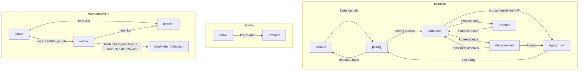

# Dokumentasi Business Logic — wa-api

> Status: terimplementasi (`cmd/waapi`, `internal/*`). Sumber: [ARCHITECTURE.md](ARCHITECTURE.md).

## Lifecycle Entitas

## Aturan per Entitas

### Instance

| Field | Rule | Catatan |
|---|---|---|
| id | Unik, slug huruf kecil | Dipakai di URL API |
| jid | Unik, terisi setelah pairing | Kosong sebelum pairing |
| status | Salah satu dari 6 status | Lihat tabel transisi |
| webhook_url | Opsional, wajib https di produksi | |
| webhook_secret | Dibuat otomatis | Untuk tanda tangan HMAC |
| rate_per_min | Default 20 | Batas kirim per instance |
| auto_start | Default aktif | Instance dinyalakan saat daemon start |

### API Key

| Field | Rule | Catatan |
|---|---|---|
| key | Ditampilkan sekali saat dibuat | Hanya hash yang disimpan |
| instance_id | Kosong = akses semua instance | Scope per instance |
| revoked_at | Terisi = key tidak berlaku | Efek instan |
| last_used_at | Diperbarui berkala (60 detik) | Bukan per request |

### Webhook Outbox

| Field | Rule | Catatan |
|---|---|---|
| attempts | Maks 8 | Lebih dari itu dihapus |
| next_retry_at | Backoff eksponensial 5 detik s/d 30 menit + jitter | |
| payload | Maks 64 KB | Teks panjang dipotong |

## Transisi Status Instance

| Dari | Ke | Pemicu |
|---|---|---|
| created | pairing | Operator menjalankan pairing |
| pairing | connected | Scan QR / input kode berhasil |
| pairing | created | QR kedaluwarsa / dibatalkan |
| connected | disconnected | Koneksi jaringan putus |
| disconnected | connected | Reconnect otomatis berhasil |
| connected, disconnected | logged_out | Logout via CLI atau perangkat di-unlink dari HP |
| semua | disabled | Operator menghentikan instance |
| logged_out | pairing | Pairing ulang |

## Batasan Bisnis & Trigger

| Aturan | Detail |
|---|---|
| Tanpa riwayat chat | Pesan masuk hanya diteruskan ke webhook, tidak disimpan |
| Tanpa penyimpanan media | Media hanya transit di file sementara lalu dihapus |
| Pairing serial | Hanya satu instance boleh pairing dalam satu waktu |
| Batas kirim | Per instance sesuai rate_per_min, dengan jeda acak |
| Antrian kirim penuh | Request ditolak, klien diminta mencoba lagi |
| Instance tidak tersambung | Request kirim ditolak |
| Ukuran media | 16 MB (gambar/video/audio), 64 MB (dokumen) |
| Check number | Maks 20 nomor per request, hasil di-cache 24 jam |
| Admin | Hanya lewat terminal server (CLI), tidak ada panel web |
| Kapasitas | 3–6 instance aktif per proses agar RAM di bawah 100 MB |

